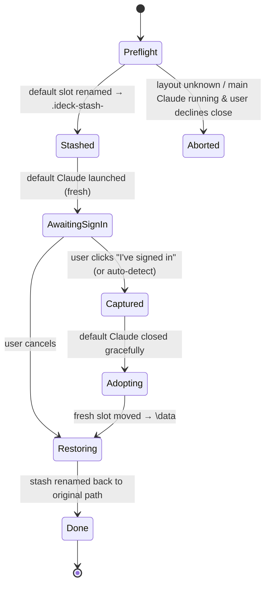

# InstanceDeck: Codex Handover

**Product:** InstanceDeck, a multi-instance app launcher for Windows
**One-liner:** Run multiple instances and accounts of your desktop apps on Windows, side by side, each in its own isolated profile.
**Owner:** Tanzir Rahman ([tanziro.com](https://tanziro.com)) · GitHub: `tanzir71`
**Prepared:** 14 Nov 2026 · research cut-off: the sources in §14
**Working folder:** `C:\Users\tanzir\Desktop\multi-instance` · target repo: `github.com/tanzir71/instancedeck`
**Design source (authority for all visuals):** Figma, Project Priority – Tack → page "InstanceDeck · landing + app · 14 Nov". Open https://www.figma.com/design/8o7PprHCNdQxS3WvHzv62e/Project-Priority---Tack?node-id=150-2297, then read `design/README.md` for frame IDs, PNG exports, `tokens.json` and build notes.

**Handover stack (read in this order):**
1. `AGENTS.md`
2. `HANDOVER.md` (this file)
3. `design/README.md`
4. The Figma frames or `design/*.png`
5. `design/tokens.json`

Codex: read the whole document before writing code. Work through the phases in §11 in order. Log progress in `PROGRESS.md` and decisions in `DECISIONS.md`. Operating rules are in `AGENTS.md`. If this document and the code you find disagree, this document wins, unless `DECISIONS.md` records a newer decision.

---

## Contents

1. Name and positioning
2. Competitor research (what we copy, what we beat)
3. Goals, non-goals, principles
4. Technical findings: how isolation actually works on Windows
5. Architecture
6. Desktop app: features and UX spec
7. Component library and Storybook (required)
8. Landing page: art direction (corporate, GitHub Pages)
9. Landing page: content, SEO and copy deck
10. Distribution, signing and trust
11. Phased build plan with acceptance criteria
12. Testing and manual QA matrix
13. Risks, open decisions
14. Sources

---

## 1. Name and positioning

### 1.1 Name: **InstanceDeck**

- **Brand:** `InstanceDeck` (one word, camel case in the wordmark, `instancedeck` in slugs).
- **Descriptor, always paired with the brand in titles and the H1 area:** "Multi-instance app launcher for Windows".
- **Metaphor:** every profile is a card in your deck. Cards are flat colour blocks, and the deck motif drives the visual identity (§8).

Why this name works for search:

| Criterion | How InstanceDeck meets it |
|---|---|
| Ownable branded search | No software product uses the name (checked Nov 2026; the nearest hit is "InstaDeck", an outdoor flooring product, which is unrelated). Branded queries will return only us. |
| Carries the category keyword | Contains "Instance", the core noun in every high-intent query ("multiple instances", "multi-instance", "second instance"). |
| No trademark entanglement | It avoids "Claude", "Codex", "ChatGPT", "Parall" and "Parallel(s)". Parallels is a registered virtualization brand, and the Android "Parallel Space" category is crowded. |
| Distinct from incumbents | The Microsoft Store already lists "Multi Instance Pro" and "Multi Instance for Claude Desktop". A generic "Multi Instance X" name would blur into them. |
| Works as a slug | `instancedeck` → `tanzir71.github.io/instancedeck/` and a matching repo name. |

Title template: `{Page topic} – InstanceDeck` for inner pages, `InstanceDeck — Run Multiple App Instances on Windows` for home.

Alternates, if Tanzir rejects the name: `Twinstance` (no collisions found, but it implies only two instances) and `Paraloom` (unique, carries no keyword). Do not use either unless `DECISIONS.md` says so.

### 1.2 Positioning

- **For:** people who own several accounts of the same desktop app (work, personal, client) and want them open at once. Developers running AI agents under separate identities. QA and support staff who need clean profiles.
- **Category:** the Windows counterpart to Parall (macOS). It works with any app that can take a separate data path, and ships first-class, tested presets for **Claude Desktop** and **Codex**, which are the two most-searched use cases right now.
- **Promise:** official apps launched untouched, isolated data, no telemetry, no credential handling.
- **Wedge versus the Claude-only tools:** one tool for Claude, Codex, VS Code, Cursor, browsers and messengers, with a public, data-driven compatibility directory. That directory doubles as the SEO engine (§9.4).

### 1.3 Required non-affiliation line (site footer, README, app About screen)

> InstanceDeck is an independent open-source project. It is not affiliated with, endorsed by or sponsored by Anthropic, OpenAI, Microsoft or any other app vendor. Claude is a trademark of Anthropic, PBC. Codex and ChatGPT are trademarks of OpenAI. All other trademarks belong to their owners.

Use third-party product names only to state compatibility. **Never use third-party logos or icons**, on the site or in the app. Use neutral monogram tiles instead (§8.6).

---

## 2. Competitor research

### 2.1 Primary references (named in the brief)

| Product | Platform / model | How it isolates | Strengths to match | Weaknesses we beat |
|---|---|---|---|---|
| **Parall** (parall.app) | macOS only. Paid, $10.99 on the Mac App Store. | Per-shortcut data folder or custom data path, HOME and environment-variable overrides, and a separate Dock identity per instance. Launches the original app without copying, repacking or re-signing it, so the app's own updater keeps working. | General-purpose model (any app). Per-instance icon and name. No background services, no telemetry. Public per-app compatibility list. Launchers for CLI tools with arguments and env. | No Windows version. Paid. Documented quirks: launch-order sensitivity, browser sign-in needing other instances closed, notifications focusing the wrong instance. |
| **Claude Desktop Manager** (claudeprofiles.com) | Windows 10 (19041+) and 11, x64 and ARM64. Freemium: free tier caps parallel use at 15 min, Standard $10 (2 instances), Pro $30 (unlimited), one-time payment. | "Isolated browser data folder" per profile; mechanism not documented. Detects the new Claude exe path after updates. Keeps Claude Code config per profile. | Tray, per-profile hotkeys and a global switcher (Ctrl+`). Auto-restart, window memory, orphan-window adoption, OAuth-popup auto-close, per-profile MCP editor, seeded profiles that copy MCP setup without logins. Colored window borders (Win 11). EN/FR/ES/DE. Honest ToS FAQ. | Claude only. Paywalled parallelism. Closed source. SmartScreen warning on install. The site contradicts itself on which tier gets which features. |
| **ai-multi-instance** (Zoltak-Dev, MIT, ~41★) | Windows 10+. Python standard library, PyInstaller exes. | Claude: `--user-data-dir` plus a per-profile `LOCALAPPDATA`. Codex: `--user-data-dir`, `CODEX_ELECTRON_USER_DATA_PATH`, `CODEX_HOME`, `CODEX_CLI_PATH`. Claude sign-in through a "snapshot" of the default instance. | The most transparent technical reference (§4). Tested against Claude Desktop 3.1623.1.0, Codex 26.1027.3384.0 and Windows 11 build 26200 on 30 Oct 2026. Robust probing of Claude's data location. Crash recovery for interrupted sign-in. | Terminal UI only. Unsigned binaries, so Smart App Control must be off. Reads and decrypts session cookies (DPAPI + AES-GCM) to show usage. Force-kills processes. Claude and Codex only. |
| **Multi Instance Pro** (Microsoft Store 9N3X1FSCLMWK; dev site sypnose.cloud) | Windows (Store). Pricing not shown on the listing. | Claims separate profile, sign-in, session and colour per instance; no mechanism given. | Dashboard, colour coding, templates (name, colour, project folder, engine preset), single-file backup and restore. "AI engine bridge" to route the Code tab to other providers. | Claude only. Opaque. Its sibling Store app "Multi Instance for Claude Desktop" (9NG247TJ47P0) says each instance needs a one-time manual sign-in. |

### 2.2 Adjacent tools seen in research

- `vodongha/claude-desktop-clone`: PowerShell setup scripts that create Work and Personal shortcuts with no admin rights and no dependencies.
- Codex account switchers (`Lampese/codex-switcher`, `codex-desktop-manager`, `codex-profiles`, CodexControl): these swap `auth.json` or the session cache and then restart Codex. That is **switching**, not parallel instances.
- `CLAUDE_CONFIG_DIR` tooling (ccswap, cyolo, Claude Account Switcher on winget): Claude Code CLI only.
- Sandboxie-Plus: AlternativeTo's top-rated "Parall alternative" (free, open source). It is heavyweight sandboxing, and users report it is fragile with Claude Desktop.
- AgentsRoom: an agent IDE with per-project Claude and Codex account pinning. It is a different category, but competes for the same searches.

### 2.3 What we copy, what we do differently

**Copy (table stakes):** isolated profiles, colour and icon identity, tray, hotkeys, shortcuts, start with Windows, auto-detection of the app path after updates, per-profile MCP config for Claude, seeding a profile from another without copying logins, crash-safe sign-in flow, honest ToS FAQ.

**Beat:**
1. **Any app, not one app.** A data-driven recipe system (§5.5) with a public compatibility directory.
2. **Trust.** Open source (MIT), signed releases (§10), no telemetry, **no credential reading or decryption**, no DLL injection, no patching of target apps.
3. **Data safety.** Graceful close before any force-kill. A journaled sign-in flow. Deletion only to the Recycle Bin, and only after explicit confirmation.
4. **Taskbar identity.** Per-profile AppUserModelID with relaunch properties, so a pinned profile relaunches as that profile (§4.6).
5. **Corporate-grade presentation.** A landing page and app UI that look like enterprise software, not a hobby script (§8).

---

## 3. Goals, non-goals, principles

### 3.1 Goals (v1.0)

1. Run N simultaneous, isolated instances of Claude Desktop and Codex (Microsoft Store/MSIX installs) on Windows 10 22H2+ and Windows 11, x64 and ARM64.
2. A general recipe engine plus a "Custom app" mode for any executable that accepts a data-path argument or environment variable.
3. A polished desktop UI (Tauri 2 + React) backed by a component library documented in Storybook.
4. A corporate, SEO-optimised static site on GitHub Pages with a recipe-generated app directory.
5. Signed installers on GitHub Releases, a winget manifest, and a Microsoft Store listing (EXE submission).

### 3.2 Non-goals (v1)

- **No usage or quota tracking that reads app cookies or tokens.** Competitors decrypt cookie stores to call internal usage endpoints. We will not: it is a credential-handling liability, it trips antivirus heuristics, and the endpoints are undocumented. Instead, the app offers "Open usage page", which deep-links to each provider's own usage page in that profile.
- **No account rotation or load-balancing across accounts.** This is the feature that crosses into "evading usage limits", which Anthropic's terms prohibit according to claudeprofiles' own FAQ. Positioning is "accounts you own, kept separate".
- No sandboxing or virtualization (that is Sandboxie's job). No DLL injection, API hooking or binary patching.
- No macOS or Linux in v1. Keep the engine's platform layer behind a trait so a macOS port (HOME override plus `open -n --args --user-data-dir`) is possible later.
- No cloud services, accounts or analytics.

### 3.3 Principles (enforced in code review)

1. **Launch the official binary, unmodified.** Isolation comes only from arguments, environment variables and data paths.
2. **Never read secrets.** The engine may stat, rename and move files in profile folders. It must never parse cookie databases, `auth.json`, `config.json` tokens or keychain/DPAPI blobs. Diagnostics redact paths that contain user names on request and never include file contents.
3. **Never lose user data.**
   - Renames instead of deletes.
   - A stash is never removed until it has been restored.
   - "Delete profile" sends the profile to the Recycle Bin, after a typed confirmation of the profile name.
   - The default action is "Remove from deck", which keeps the data.
   - Backups and stashes are never auto-pruned.
4. **Graceful first.** Close windows with `WM_CLOSE` and wait up to 8 s. Only then offer "Force close" (TerminateProcess on the tree) with a confirmation.
5. **Fail closed on unknown layouts.** If the engine cannot prove where an app keeps its default data, it refuses the sign-in flow rather than risk landing an account in the wrong profile. This is the lesson of ai-multi-instance v2.0.1.
6. **Everything observable.** Every launch writes a structured log line (recipe id, recipe version, app version, strategy used, exit status). A Diagnostics screen shows it.

---

## 4. Technical findings: how isolation works on Windows

All of this is empirical and version-sensitive. Encode each fact in the relevant **recipe** with `verifiedOn` metadata, never as hard-coded engine logic.

### 4.1 Electron single-instance basics

Electron apps call `app.requestSingleInstanceLock()`. The lock is scoped to the app's **userData directory**. Give an instance a different userData directory before that call and it becomes a separate instance. Chromium's `--user-data-dir=<path>` does this for most Electron and Chromium apps. Some apps call `app.setPath('userData', …)` themselves before the lock, which defeats the flag, and need app-specific environment variables (Codex, §4.3). Some relocate userData using `%LOCALAPPDATA%` read from the **environment** (Claude, §4.2), which is why overriding that variable per process works there.

Caveat: Windows Known Folder APIs (`SHGetKnownFolderPath`) ignore environment variables. An env override only works when the app reads the env var itself. Never assume it works for a new app; verify it per recipe.

### 4.2 Claude Desktop (Windows)

- **Packaging:** the official installer from claude.ai, the Microsoft Store build and `winget install Anthropic.Claude` all install an **MSIX** package.
  - Package family: `Claude_pzs8sxrjxfjjc`.
  - Install location: `C:\Program Files\WindowsApps\Claude_<version>_x64__pzs8sxrjxfjjc\` (changes on every update).
  - Main exe: `<InstallLocation>\app\claude.exe`. Legacy Squirrel installs live in `%LOCALAPPDATA%\AnthropicClaude\`. Support both, preferring MSIX.
- **Default-instance data has lived in three places across versions.** Probe the contents; never trust the path alone. In order:
  1. `%LOCALAPPDATA%\Claude-Data\claude_pzs8sxrjxfjjc` (recent)
  2. `%LOCALAPPDATA%\Packages\Claude_pzs8sxrjxfjjc\LocalCache\Roaming\Claude` (MSIX virtualized `%APPDATA%`)
  3. `%APPDATA%\Claude` (unpackaged)

  A folder counts as live userData if it contains any of `Local State`, `Preferences` or `Network`, **and** it contains no `.user-data-left*` relocation marker.
- **Isolation recipe** (from ai-multi-instance v2.0.1):
  - Launch `claude.exe --user-data-dir=<profile>\data` with the env var `LOCALAPPDATA=<profile>\localappdata`.
  - Recent Claude versions relocate userData under `%LOCALAPPDATA%` before the single-instance check. Without the env override, a "profile" opens the main account.
  - Child tools such as the bundled Claude Code inherit that `LOCALAPPDATA`, so their caches separate too.
- **Claude Code config:** also set `CLAUDE_CONFIG_DIR=<profile>\claude-code` (per-profile toggle, default on). The variable is widely used and present in the binary but **not officially documented**, so treat it as best-effort and label it "experimental" in the UI. Users isolating several accounts report combining `CLAUDE_CONFIG_DIR` with `--user-data-dir`.
- **MCP config:** `claude_desktop_config.json` lives inside the profile's userData, so it is per-profile automatically. Offer "Copy MCP config from…", which copies **only that file**.
- **Sign-in constraint:** sign-in goes through the browser and returns via the `claude://` protocol. Windows delivers that callback to the **default** (package) instance, never to a profile. Strategies, in order:
  1. **In-profile sign-in (spike):** check whether the current Claude build offers a sign-in path that completes inside the app with no protocol callback, such as an emailed code. If it does, prefer it and document it per version.
  2. **Snapshot sign-in (ship this):**
     1. Stash the default slot by renaming it.
     2. Launch the default Claude and let the user sign in there normally.
     3. Close it gracefully.
     4. Move the fresh default slot into the profile.
     5. Restore the stash.

     DPAPI is scoped to the Windows user, not to the folder, so moved sessions stay valid. Spec in §6.4.
  3. **Protocol broker (time-boxed spike, 1 day, may fail):** register InstanceDeck as an additional `claude:` handler under HKCU, so the user picks "InstanceDeck" once in Windows' handler chooser. Then forward the callback URL by launching `claude.exe --user-data-dir=<awaiting profile> "<url>"`. Electron hands the argv to the running profile instance via `second-instance`. The kill criteria are in §11, P3.
- **Cowork VM:** Cowork uses a machine-wide VM service (`CoworkVMService`). Chat and account isolation work, but concurrent Cowork VMs across profiles are **unverified** (ai-multi-instance issue #5). Show a one-line limitation note on Claude profiles. Do not claim support.

### 4.3 Codex desktop app (Windows)

- **Packaging:** Microsoft Store MSIX.
  - Package name: `OpenAI.Codex`. Family: `OpenAI.Codex_2p2nqsd0c76g0`.
  - Entry exe: `<InstallLocation>\app\ChatGPT.exe`.
  - **Do not launch `app\Codex.exe`.** It is the updater trampoline and carries a process trust label, so `CreateProcess` fails with error 5 (access denied).
  - The default Codex home is `%USERPROFILE%\.codex`, shared with the native Codex CLI.
- **Isolation recipe** (ai-multi-instance v2.0.1):
  - Arguments: `--user-data-dir=<profile>` (kept for process tracking).
  - `CODEX_ELECTRON_USER_DATA_PATH=<profile>\electron`. Codex reads this before its singleton check; it is what actually allows parallel instances.
  - `CODEX_HOME=<profile>\codex-home` (auth, sessions, config).
  - `CODEX_CLI_PATH=<InstallLocation>\app\resources\codex.exe`, if present. This avoids package-identity errors after updates.
- **Sign-in:** happens inside each profile through the normal sign-in screen. No snapshot needed.
- **Known risk:** one community tool reports that the Desktop app-server "sometimes ignores `CODEX_HOME` and reads `~\.codex\auth.json`". The QA matrix must verify, per Codex version, that profile B shows account B. Surface any mismatch as a recipe health warning.
- **Optional "shared history" mode (P5):** link a profile's `codex-home\sessions` to a shared folder with a directory junction. Some users want one history across accounts. Off by default.

### 4.4 Launch strategies for MSIX targets

The engine tries these in order and records which one worked per app version:

1. **Direct `CreateProcessW`** on `<InstallLocation>\app\<exe>`, with a custom environment block and arguments. This is what ai-multi-instance does, verified 30 Oct 2026. Use `DETACHED_PROCESS | CREATE_NEW_PROCESS_GROUP | CREATE_UNICODE_ENVIRONMENT`.
2. **Package-context fallback:** run the exe inside its package context. In PowerShell this is `Invoke-CommandInDesktopPackage -PackageFamilyName <family> -AppId App -Command <exe> -Args <args> -PreventBreakaway`, with a generated `.cmd` wrapper that sets the env vars and then starts the exe. A community write-up found this necessary for Codex when direct execution later returned "Access is denied"; `-PreventBreakaway` keeps package context. Implement it by spawning `powershell.exe -NoProfile` hidden. Generate wrapper files in `%LOCALAPPDATA%\InstanceDeck\run\`, written as UTF-16LE with BOM, and test with a non-ASCII user-profile path.
3. If both fail: show a clear error with a "Copy diagnostic report" button. Never retry in a loop.

**Executable discovery:** use WinRT `Windows.Management.Deployment.PackageManager.FindPackagesForUser("", familyName)` through the `windows` crate. Do not shell out to `Get-AppxPackage` on the hot path. Pick the highest version. Cache it per session and re-resolve on launch failure; the path changes on every update.

### 4.5 Generic apps: initial recipe candidates

These need verification before they are marked "Verified" (§12).

| App | Mechanism | Notes |
|---|---|---|
| Visual Studio Code | `Code.exe --user-data-dir=<p>\data --extensions-dir=<p>\extensions` | Officially supported flags. |
| Cursor | Same flags as VS Code (VS Code fork) | Verify. |
| Google Chrome / Microsoft Edge / Brave | `--user-data-dir=<p>` | Native profiles exist; our value is a separate taskbar identity and window. |
| Telegram Desktop | `Telegram.exe -workdir "<p>"` | Separate data directory per instance. |
| Discord | Candidate: `--multi-instance` plus data path through Squirrel `Update.exe --processStart` | Unverified on Windows; mark "community". |
| Custom app | User-defined args and env templates | Isolation level is reported as "Unknown" until the user marks it as working. |

### 4.6 Taskbar and window identity

The community Codex write-up is the reference for this.

- **Shortcuts:** create `.lnk` files with `IShellLinkW` + `IPropertyStore`. Set `System.AppUserModel.ID = InstanceDeck.<appId>.<profileId>`. Save with read/write mode, `Commit()` and `IPersistFile::Save()`, then reload to verify; a read-only load can appear to succeed without persisting. Icon: the target app's icon with a generated colour badge (.ico, multi-size 16 to 256).
- **Running windows:** use `SetWinEventHook(EVENT_OBJECT_CREATE … EVENT_OBJECT_SHOW, WINEVENT_OUTOFCONTEXT)` filtered to PIDs launched for a profile. Wait for a non-zero, stable main HWND (stable for 750 ms, 20 s timeout). Then:
  - `SHGetPropertyStoreForWindow(hwnd)`: set `PKEY_AppUserModel_ID`, `PKEY_AppUserModel_RelaunchCommand` (= `InstanceDeck.exe launch <profileId>`), `PKEY_AppUserModel_RelaunchDisplayNameResource` (= profile name) and `PKEY_AppUserModel_RelaunchIconResource`. Result: separate taskbar groups per profile, and a pinned button relaunches the profile.
  - Optional: `DwmSetWindowAttribute(DWMWA_BORDER_COLOR)` with the profile colour on Windows 11. **Spike:** verify it works on another process's window. If it does not, drop it; no injection allowed.
  - Serialize concurrent launches with a named mutex `Local\InstanceDeck.Launch`.
- Note: passing `--app-user-model-id` to Codex did **not** prevent initial grouping under the default identity in community testing. Rely on the window property store.

### 4.7 Process tracking and close

- Enumerate processes and their command lines with the `sysinfo` crate (it reads the PEB on Windows), or WMI as a fallback.
- A profile is "running" if any process whose exe sits under the recipe's install path has a command line containing that profile's `--user-data-dir` value (case-insensitive, normalized path).
- The main (default) instance is the packaged exe with **no** `--user-data-dir`.
- Close sequence:
  1. Find top-level visible windows of the matching PID tree and post `WM_CLOSE`.
  2. Wait up to 8 s.
  3. If processes remain, offer "Force close". On confirmation, call `TerminateProcess` on the tree.

---

## 5. Architecture

### 5.1 Stack (locked)

- **Desktop:** Tauri 2 (latest stable), Rust stable, React 19 + TypeScript + Vite. This is the same family as Tanzir's other desktop projects (Lameh Desktop, Intercept).
- **UI:** in-house component library (`packages/ui`) built on Radix UI primitives for accessibility, CSS Modules plus CSS custom-property design tokens. State: Zustand. Data fetching from Rust: typed Tauri commands generated with `tauri-specta`.
- **Icons:** the app's nav glyphs are the custom filled shapes in `design/assets/icons/` (they use `currentColor`). For everything else, use Fluent UI System Icons, **filled** variants only (MIT). No stroke icon sets anywhere.
- **Site:** Astro (latest), static output, React components from `packages/ui` rendered to static HTML (zero JS by default; hydrate islands only where needed). Deployed to GitHub Pages via Actions.
- **Monorepo:** pnpm workspaces plus Turborepo. Node LTS.

### 5.2 Repository layout

```
instancedeck/
├─ AGENTS.md  HANDOVER.md  PROGRESS.md  DECISIONS.md  README.md  LICENSE (MIT)
├─ SECURITY.md  PRIVACY.md  CODE_SIGNING_POLICY.md  CONTRIBUTING.md
├─ apps/
│  ├─ desktop/                 # Tauri 2 app
│  │  ├─ src/                  # React app (screens compose packages/ui)
│  │  └─ src-tauri/
│  │     ├─ src/commands/      # thin Tauri command layer
│  │     └─ crates/ → (see crates/)
│  └─ site/                    # Astro marketing + docs site
├─ crates/
│  ├─ ideck-core/              # platform-agnostic: profiles, recipes, templating, journal
│  ├─ ideck-win/               # Windows impl: discovery, launch, process, shell, window identity
│  └─ ideck-cli/               # `ideck` CLI over core+win, for scripting and tests
├─ packages/
│  ├─ ui/                      # component library + tokens + Storybook
│  │  ├─ src/tokens/           # tokens.json → CSS vars + TS (Style Dictionary)
│  │  ├─ src/components/       # app components
│  │  ├─ src/marketing/        # site section components (also in Storybook)
│  │  └─ .storybook/
│  └─ recipes/                 # *.recipe.json + recipe.schema.json (shared by app + site)
└─ .github/workflows/          # ci.yml, release.yml, pages.yml
```

### 5.3 Data locations

- App state: `%LOCALAPPDATA%\InstanceDeck\` (`settings.json`, `profiles.json`, `journal\`, `logs\`, `run\`, `icons\`).
- **Profiles root** (user-configurable, so profiles can live on another drive): `%LOCALAPPDATA%\InstanceDeck\Profiles\<appId>\<profileId>\`.
- Profile IDs are ULIDs. Display names are free text. Folder names never depend on the display name, so renames are cheap and safe.
- `profiles.json` schema (versioned; migrations in `ideck-core`):

```json
{
  "schemaVersion": 1,
  "profiles": [{
    "id": "01JC…",
    "appId": "claude-desktop",
    "name": "Client — Acme",
    "color": "terracotta",
    "badge": "monogram",
    "dataDir": "D:\\Profiles\\claude-desktop\\01JC…",
    "options": { "isolateClaudeCode": true, "sharedCodexHistory": false },
    "hotkey": "Ctrl+Alt+1",
    "createdAt": "2026-11-14T08:00:00Z",
    "lastLaunchedAt": null,
    "signInState": "signed-in | unknown | needs-sign-in"
  }]
}
```

### 5.4 Engine flow

```mermaid
flowchart LR
  UI[React UI / CLI] -->|launch(profileId)| Core[ideck-core]
  Core --> R[Recipe resolve + template expand]
  R --> D[ideck-win discovery: PackageManager / registry / paths]
  D --> L{Launch strategy}
  L -->|1| CP[CreateProcessW + env block]
  L -->|2| PKG[Invoke-CommandInDesktopPackage wrapper]
  CP --> W[Window identity hook]
  PKG --> W
  W --> T[Process tracker → status events → UI]
```

### 5.5 Recipe system (`packages/recipes`)

Recipes are JSON, validated by `recipe.schema.json` (generate it from Rust types with `schemars`, so app and site share one schema). Template tokens: `{profile}`, `{installDir}`, `{exeDir}`, `{userProfile}`, `{localAppData}`.

```json
{
  "id": "codex",
  "recipeVersion": 3,
  "name": "Codex",
  "vendor": "OpenAI",
  "category": "ai",
  "discovery": [
    { "type": "msix", "packageFamily": "OpenAI.Codex_2p2nqsd0c76g0", "exe": "app\\ChatGPT.exe" }
  ],
  "launch": {
    "args": ["--user-data-dir={profile}"],
    "env": {
      "CODEX_ELECTRON_USER_DATA_PATH": "{profile}\\electron",
      "CODEX_HOME": "{profile}\\codex-home",
      "CODEX_CLI_PATH": "{exeDir}\\resources\\codex.exe?"
    },
    "strategies": ["direct", "package-context"]
  },
  "isolation": "full",
  "signIn": { "strategy": "in-profile" },
  "processMatch": { "exeName": "ChatGPT.exe", "arg": "--user-data-dir={profile}" },
  "limitations": ["Verify each update that the profile shows its own account (CODEX_HOME)."],
  "verifiedOn": [{ "appVersion": "26.1027.3384.0", "os": "Windows 11 26200", "date": "2026-10-30", "by": "ai-multi-instance (upstream report)" }],
  "status": "community",
  "seo": {
    "slug": "codex",
    "title": "Multiple Codex App Accounts on Windows",
    "description": "Run several Codex desktop accounts side by side on Windows, each with its own CODEX_HOME and app data. Free, open source."
  }
}
```

- A trailing `?` on an env value means "set only if the path exists".
- `status` is one of `verified` (Tanzir ran the QA checklist), `community` or `experimental`.
- The site renders this field honestly; never upgrade it automatically.
- Ship built-in recipes: `claude-desktop`, `codex`, `vscode`, `cursor`, `chrome`, `edge`, `brave`, `telegram-desktop`.

### 5.6 Rust crates to use

`windows` (features: Win32_UI_Shell, Win32_UI_Shell_PropertiesSystem, Win32_System_Com, Win32_UI_WindowsAndMessaging, Win32_UI_Accessibility, Win32_Graphics_Dwm, Win32_System_Threading, Management_Deployment), `sysinfo`, `serde`, `serde_json`, `schemars`, `ulid`, `trash` (Recycle Bin), `notify` (file events for sign-in detection), `tracing` + `tracing-appender`, `thiserror`, `anyhow` (bin only), `ico` + `image` (badge icons).

Tauri plugins: `single-instance` (for InstanceDeck itself), `global-shortcut`, `autostart`, `updater`, `dialog`, `opener`, `window-state`, `log`. Use the built-in tray icon API.

Every Windows-specific module sits behind a trait in `ideck-core`, with a fake implementation for unit tests.

---

## 6. Desktop app: features and UX spec

### 6.1 Screens

1. **Deck (home).**
   - A grid of profile cards grouped by app. Each card is a flat colour block showing a monogram, the profile name, an app label in mono, a status dot, and Launch / Focus / Close actions.
   - The top row per app is the **Main instance** (the normal app, unmanaged; launch and close only).
   - Empty state: illustration plus "Add your first profile".
2. **New profile wizard (3 steps).**
   1. Pick an app (detected apps first, with version and install type; "Custom app" last).
   2. Name, colour (8 swatches), data location (default or browse).
   3. Options (isolate Claude Code, shortcuts to create, hotkey). For Claude, finish with "Sign in now".
3. **Profile detail (side panel).**
   - Rename, colour, data folder (open in Explorer), launch arguments (read-only view of the resolved recipe), shortcuts, hotkey, Claude MCP config copy.
   - Danger zone: "Remove from deck" (keeps data) and "Delete profile data" (Recycle Bin, typed confirmation).
4. **Claude sign-in assistant** (modal, §6.4).
5. **Apps.** Detected apps, recipe status badges, versions, install paths. "Add custom app".
6. **Diagnostics.** Environment, detected layouts, last 50 launch log lines, recipe health checks, "Copy diagnostic report" (no file contents; user-name redaction toggle).
7. **Settings.** Profiles root, start with Windows, close-to-tray, global switcher hotkey (default `Ctrl+Alt+Space`), update channel (stable or beta, checked only when the user allows), theme (light or dark; light is the default).

### 6.2 Tray and switcher

- **Tray menu:** profiles grouped by app, each with a launch or focus item. Then "Open InstanceDeck", then Quit.
- **Global switcher:** a small palette window. Type to filter profiles; Enter launches or focuses.

### 6.3 Shortcuts

Per profile, optionally create Desktop and Start Menu shortcuts (Start Menu folder `InstanceDeck`). Each shortcut targets `InstanceDeck.exe launch <profileId>`; InstanceDeck's own single-instance plugin forwards the request to the running manager, or launches headless. Windows does not allow programmatic taskbar pinning. Instead, show a one-line tip: "Launch the profile, then right-click its taskbar button → Pin". The relaunch properties (§4.6) make the pin work.

### 6.4 Claude snapshot sign-in: journaled state machine



Rules:

- **Preflight:**
  - Resolve the live default slot (§4.2).
  - If the layout is unknown, or a relocation marker exists without a live slot, abort with an explanation.
  - Ask before closing a running main Claude (graceful close).
  - Check free space is at least 2× the stash size. Stash by renaming on the same volume.
- **Journal:** write `journal\signin-<ts>.json` with fsync **before** every transition (state, paths, timestamps).
  - On app start, an unfinished journal opens a recovery dialog: "Resume" or "Restore my main Claude".
  - The stash is never deleted until it has been restored successfully. On any adoption error, restore.
- **Auto-detect:** watch file **metadata only** (`notify` events and mtimes) on the fresh slot's `Network\Cookies`, its `-journal`/`-wal` files and `config.json`. A burst of writes after launch plus 3 s of quiet enables the "Looks signed in — finish" button. Never read file contents. The manual "I've signed in" button is always available.
- **Renames:** retry with backoff (handles linger for a few seconds after process exit). Up to 10 tries over 15 s, then fail to the Restoring state.
- **UX copy:**
  - "We'll briefly set your main Claude aside so this sign-in lands in **{profile}**. Your main account comes back automatically."
  - Progress steps are shown as a numbered list. There is no spinner-only state.

### 6.5 Error and empty states (write these strings in `packages/ui/src/copy/en.json`)

- App not found: "{App} isn't installed for this Windows user. Install it, then click Refresh."
- Launch blocked: "Windows blocked the launch ({code}). We tried {strategies}. Copy the report and open an issue."
- Updated app: "{App} updated to {version}. Profiles still work. If anything looks wrong, run a health check."

### 6.6 Accessibility and i18n

- WCAG 2.2 AA. Full keyboard navigation. Visible focus (2 px accent outline, offset 2 px; this is the only allowed stroke).
- Screen-reader labels on every icon button. Respect `prefers-reduced-motion`.
- English first. All strings live in `en.json`, ready for FR, ES and DE later.

---

## 7. Component library and Storybook (required)

This is Tanzir's standing requirement for every build. It applies even to screens that look one-off.

- `packages/ui` is the single source for tokens, components and marketing sections. Both the Tauri app and the Astro site import from it.
- **Start from the Figma components.** Button, MonogramTile, Eyebrow, Badge, InstanceCard, ProfileCard, MainInstanceCard, AddProfileCard, FAQItem and Logo map 1:1 to React components; variants and props are listed in `design/README.md`. Generate `tokens.json` → CSS variables from `design/tokens.json`.
- **Storybook (latest)** with `@storybook/react-vite`. Required addons: a11y, interactions/test-runner, themes (light/dark), viewport.
  - **Every** component and every screen state (empty, loading, error, N profiles, long names, RTL smoke test) has a story.
  - Marketing sections have stories at 1440, 1024, 768 and 390 widths.
- Components (minimum):
  - Primitives: Button (primary, secondary, quiet, danger), IconButton, Input, Select, Switch, Checkbox, ColorSwatchPicker, Tooltip, Dialog, Sheet/SidePanel, Toast, Tabs, Menu, Kbd, Badge (status: verified, community, experimental), StatusDot.
  - App-level: ProfileCard, AppGroupHeader, Wizard/Stepper, EmptyState, LogTable, KeyValueList.
  - Marketing: SiteHeader, Hero, LogoText strip (text only), FeatureTriplet, StepsRow, UseCaseGrid, SpotlightSplit, SecurityBand, ComparisonTable, FAQ (native `<details>`), CTABand, SiteFooter, AppDirectoryCard, Breadcrumbs, DocLayout.
- Tokens: `tokens.json` (Style Dictionary) → CSS variables plus TS constants. A stylelint rule **forbids `box-shadow`** (except `none`) and forbids `border` on surface components. Separation comes from tonal surfaces and spacing.
- Publish the built Storybook into the Pages artifact at `/instancedeck/storybook/` with `<meta name="robots" content="noindex">`.

---

## 8. Landing page: art direction

### 8.1 Brief

An aesthetic, professional corporate site that holds its own next to Microsoft, IBM and the Big Four accounting firms (Deloitte, PwC, EY, KPMG), hosted on GitHub Pages.

**Study these** (structure and restraint only; copy no assets, logos or exact layouts):

- **ibm.com** and the **Carbon Design System:** flat colour bands, sharp 0-radius blocks, a visible 2x grid, IBM Plex type, one strong accent.
- **microsoft.com** and **Fluent 2:** product imagery on flat colour fields, confident whitespace, calm navigation.
- **deloitte.com:** near-monochrome with a single accent, editorial headline scale.
- **pwc.com:** editorial serif headlines, tonal colour blocks.
- **kpmg.com** and **ey.com:** disciplined grids, data-as-design (facts set large).

### 8.2 Taste rules (Tanzir's, non-negotiable)

- **Flat colours only.** No gradients, mesh blobs, glassmorphism, glows or noise.
- **No drop shadows.** Anywhere: not on cards, buttons, menus, screenshots or the header on scroll.
- **No strong strokes or outlined boxes.** They read as wireframes or AI slop. Separate with tonal surface steps and whitespace. Allowed exceptions: the focus outline, and 1 px table row rules at ≤ 8% contrast.
- **Ample whitespace.** More visuals, less text. Layouts must feel **art-directed**: asymmetric editorial grid, oversized type, full-bleed colour bands, deliberate alignment to the 12-column grid. No template-looking rows of identical cards.
- **Avoid:** emoji, sparkles, stroke icons, stock photos of people at laptops, "Supercharge your workflow" phrasing, fake logo walls, fake testimonials, invented metrics.
- **Design authority: the Figma frames** (see `design/README.md`). They override this section, and their text is the final copy. For every built section, put a side-by-side screenshot (Figma export | built page) in `PROGRESS.md`.

### 8.3 Design tokens (light theme is the default; dark is P5)

| Token | Value | Use |
|---|---|---|
| `--ink` | `#0F1419` | Primary text |
| `--ink-2` | `#3D4651` | Secondary text |
| `--ink-3` | `#646D78` | Tertiary text and captions (darkened from #6B7480 so it passes 4.5:1 on `--canvas` too) |
| `--paper` | `#FFFFFF` | Base surface |
| `--canvas` | `#F4F5F6` | Section band 1 |
| `--canvas-2` | `#E9EBED` | Section band 2, secondary buttons |
| `--deep` | `#0E1A2B` | Dark bands (security, footer) |
| `--accent` | `#1F4FE0` | Primary actions and links (Cobalt) |
| `--accent-hover` | `#1A43C2` | Hover |
| `--accent-tint` | `#E8EEFD` | Selected and tinted surfaces |
| `--accent-on-deep` | `#8FA8FF` | Links and accents on `--deep` (7.7:1) |
| `--success` | `#1E7F52` | Running dot on light surfaces, completed step |
| `--ochre-tint` | `#F4EEDF` | Experimental badge background |
| `--alpha-paper-16/40/56/72/80` | white at 16 / 40 / 56 / 72 / 80% | Translucent fills and text on profile colours and `--deep` (exact uses in `design/tokens.json`) |
| `--alpha-ink-48` | `rgba(15,20,25,.48)` | Dialog scrim |

**Profile palette** (flat; used for instance cards in visuals and in the app): terracotta `#B84A33`, teal `#2A7F75`, iris `#5B4FC7`, ochre `#8F6A12`, sky `#2F6FCB`, plum `#9C3F78`, moss `#4F7A35`, graphite `#5E6670`.

- Terracotta and ochre were darkened during the Figma pass so that white labels reach at least 4.5:1 on every swatch. The values above and in `design/tokens.json` are final.
- Still write the contrast test (`packages/ui/scripts/contrast.ts`) so the palette cannot regress.

**Typography** (all OFL, self-hosted via Fontsource, subset to Latin, `font-display: swap`, preload the two hero weights):

- Display (H1 and H2): **Source Serif 4**, variable with optical size, weights 400 and 600. Gives the editorial, consulting-firm authority.
- UI and body: **IBM Plex Sans**, 400, 500 and 600.
- Labels, eyebrows and technical facts: **IBM Plex Mono**, 400 and 500.
- Scale (px): 12 / 14 / 16 / 18 / 20 / 24 / 32 / 40 / 56 / 72 / 88. H1 is 72–88 on desktop and 44 on mobile, line-height 1.02, tracking −0.02em. Body is 18/1.6. Eyebrows are in sentence case, not all caps.

**Grid and space:**

- 12 columns. Max content width 1280, full-bleed bands to the viewport. Gutters 32 (desktop) and 16 (mobile).
- Spacing scale: 4, 8, 12, 16, 24, 32, 48, 64, 96, 128, 160. Section padding 128–160 vertical on desktop.
- **Radius:** 0 on surfaces, images and cards; 2 px on buttons and inputs.

**Motion:**

- 160–240 ms, ease-out.
- The hero deck fans in once on load (cards translate and rotate a few degrees). No parallax. No scroll-jacking.
- Everything is disabled under `prefers-reduced-motion`.

### 8.4 Components (site)

- **Header:**
  - White bar: wordmark on the left; links "Product", "How it works", "Apps", "Security", "Docs"; primary button "Download" on the right.
  - Sticky. On scroll the background stays white with no shadow; a `--canvas` strip under the header acts as the separator.
  - Mobile: full-screen sheet menu.
- **Buttons:** primary is `--accent` fill with a white label, 48 px tall. Secondary is `--canvas-2` fill with an `--ink` label and no outline. Text links use a 1 px underline at offset 3 px.
- **Footer** (on `--deep`):
  - Four columns: Product, Resources, Project, Legal.
  - A bottom row with © year, the non-affiliation line (§1.3) and the **credit line:**

    > Designed and built by **[Tanzir Rahman](https://tanziro.com)** · [tanziro.com](https://tanziro.com)

    Make this a normal followed link (no `nofollow`). It appears on every page.

### 8.5 Hero composition (home)

- Left (7 columns):
  - Mono eyebrow "Multi-instance app launcher for Windows".
  - Serif H1.
  - Sans sub-headline (max 2 lines at desktop).
  - Two buttons.
  - Mono meta line.
- Right (5 columns, bleeding to the viewport edge on a `--canvas` field): **the Deck**, five flat `InstanceCard`s (240×320) fanned like a hand of cards at −10°, −5°, 0°, 5° and 10° around a pivot 1000 px below the card centre. Each card shows a monogram tile, a profile name, an app label in mono and a profile path. Exact positions, colours, card copy and the load animation are in `design/README.md` → "Build notes". Build it in HTML/CSS, not a raster image, so it stays sharp and light.
- Below the fold: real product screenshots, light theme, placed on flat colour fields with 0 radius, no device frames and no shadows. Until the app exists, use `design/20-app-deck@2x.png` on the `--accent` field, as shown in Figma frame `158:2481`. Export real screenshots from the app or Storybook at 2x and serve them as AVIF/WebP via `astro:assets`.

### 8.6 Third-party app depiction

Never draw vendor logos. Represent apps as **monogram tiles**: a square in a neutral `--canvas-2` with a 2-letter monogram in Plex Mono (for example "Cl", "Cx", "VS"), plus the product name in text. This applies to the hero, the "Works with" strip and the app directory.

---

## 9. Landing page: content, SEO and copy deck

### 9.1 Site map

| URL path (under base) | Purpose | Primary query |
|---|---|---|
| `/` | Home | run multiple instances of apps on Windows |
| `/claude-desktop-multiple-accounts/` | Claude guide plus product pitch | claude desktop multiple accounts windows |
| `/codex-multiple-accounts/` | Codex guide plus product pitch | codex app multiple accounts windows |
| `/apps/` | Compatibility directory (generated from recipes) | multi-instance app compatibility |
| `/apps/{slug}/` | One page per recipe (generated) | run two instances of {app} on windows |
| `/how-it-works/` | Isolation model explained | how to run multiple instances of electron apps |
| `/compare/parall-for-windows/` | Fair comparison | parall alternative for windows / parall for windows |
| `/security/` | Security model, threat model, signing | — (trust) |
| `/privacy/` | Privacy policy (no data collected) | — |
| `/code-signing-policy/` | Required by SignPath Foundation | — |
| `/download/` | Latest release, checksums, SmartScreen help | instancedeck download |
| `/changelog/` | Built from GitHub Releases at build time | — |
| `/faq/` | Full FAQ | — |
| `/404.html` | Custom 404 with search links | — |

### 9.2 GitHub Pages specifics (important)

- Project site URL: `https://tanzir71.github.io/instancedeck/`. In Astro set `site: 'https://tanzir71.github.io'` and `base: '/instancedeck'`. Build every internal URL from `import.meta.env.BASE_URL`; add a test that fails on any absolute `/` link.
- **`robots.txt` only works at the host root.** Crawlers ignore `/instancedeck/robots.txt`. So:
  1. Submit the sitemap directly in Google Search Console and Bing Webmaster Tools, using URL-prefix properties verified by `<meta>` tags. The verification tokens come from env at build: `PUBLIC_GSC_TOKEN`, `PUBLIC_BING_TOKEN`.
  2. Use per-page `<meta name="robots">` for anything that must not be indexed (Storybook).
  3. Make `SITE_URL` and `BASE_PATH` env-driven, so moving to a custom domain is a one-line change (open decision in §13).
- Limits that shape the build: published site ≤ 1 GB, soft bandwidth 100 GB/month, deploy timeout 10 minutes, and no use as hosting for commercial SaaS or e-commerce.
  - Host **binaries on GitHub Releases**, never in the Pages artifact.
  - Any paid tier must check out on an external platform. Pages may only link to it.
- No server headers on Pages. Set security-relevant meta where possible (`referrer`, a CSP `<meta>` limited to self plus GitHub API at build time; no runtime third-party requests). Add `.nojekyll`.
- Deploy workflow (`.github/workflows/pages.yml`): trigger on push to `main` touching `apps/site/**`, `packages/**` or `recipes/**`, plus `workflow_dispatch`. Steps: pnpm install → build the site and Storybook → copy Storybook into `dist/storybook` → `actions/upload-pages-artifact` → `actions/deploy-pages`. Use current major versions, `permissions: pages: write, id-token: write`, and a concurrency group `pages`.
- After deploy, ping **IndexNow** (Bing, Yandex) with changed URLs. The key file lives in `public/`.

### 9.3 Technical SEO checklist (each page)

- [ ] Unique `<title>` ≤ 60 chars and meta description ≤ 155 chars, from page frontmatter.
- [ ] Exactly one `<h1>` that contains the page's primary query. Logical H2 and H3 structure.
- [ ] Self-referencing canonical (absolute URL with base). `hreflang` is not needed yet.
- [ ] Open Graph and Twitter cards. **OG images generated at build** (Satori + Resvg) in the flat brand style, 1200×630, with page title, monogram tiles and the deck motif.
- [ ] JSON-LD (see below). Validate in CI with `schema-dts` types plus a structured-data lint script.
- [ ] `@astrojs/sitemap`, with `lastmod` from git commit dates.
- [ ] Breadcrumbs (visible plus `BreadcrumbList`) on all inner pages.
- [ ] Internal linking: every app page links to 3 related apps and back to `/apps/`, the Claude and Codex pages cross-link, and the FAQ links to deep pages.
- [ ] Image `alt` text that describes, `width` and `height` set, lazy-loaded below the fold, AVIF/WebP.
- [ ] Performance budget: LCP < 1.8 s (slow 4G, mid-tier mobile), CLS < 0.05, total JS on home < 20 KB gzipped, no third-party scripts, fonts ≤ 4 files preloaded at most 2.
- [ ] Lighthouse CI (`@lhci/cli`) in the workflow: ≥ 95 for Performance, Accessibility, Best Practices and SEO on `/`, one app page and `/faq/`. **The build fails below threshold.**
- [ ] `llms.txt` at the base path: a plain-language product summary, links to key pages, and the non-affiliation statement (for AI search assistants).
- [ ] No fake `aggregateRating`, review counts, download counters or "trusted by" logos. GitHub stars may show only if fetched from the GitHub API at build time.

JSON-LD (home):

```json
{
  "@context": "https://schema.org",
  "@type": "SoftwareApplication",
  "name": "InstanceDeck",
  "alternateName": "InstanceDeck multi-instance app launcher",
  "applicationCategory": "UtilitiesApplication",
  "operatingSystem": "Windows 10, Windows 11",
  "processorRequirements": "x64, ARM64",
  "isAccessibleForFree": true,
  "offers": { "@type": "Offer", "price": "0", "priceCurrency": "USD" },
  "license": "https://opensource.org/licenses/MIT",
  "softwareVersion": "{{latestReleaseTag}}",
  "downloadUrl": "https://github.com/tanzir71/instancedeck/releases/latest",
  "url": "https://tanzir71.github.io/instancedeck/",
  "author": { "@type": "Person", "name": "Tanzir Rahman", "url": "https://tanziro.com", "sameAs": ["https://medium.com/@tanzir71", "https://github.com/tanzir71"] },
  "description": "Run multiple instances and accounts of desktop apps like Claude Desktop, Codex and VS Code side by side on Windows, each in an isolated profile."
}
```

Also emit `WebSite` (home), `BreadcrumbList` (inner pages) and `FAQPage` (`/faq/` only). Google shows FAQ rich results only for a few authoritative sites, so treat that markup as semantic help, not a ranking bet.

### 9.4 Programmatic app directory (the SEO engine)

Each recipe generates `/apps/{slug}/`:

- H1: "Run multiple instances of {App} on Windows".
- A 2-sentence intro written per recipe in `seo.intro`. No templated filler; each intro states the real mechanism.
- A status badge (Verified, Community or Experimental) plus the "Last verified" date and versions table from `verifiedOn`.
- "How InstanceDeck isolates {App}": the actual flags and env vars, shown transparently. This is genuinely useful to the reader and it builds trust.
- Steps (3), limitations, and 3 related apps.
- Pages with `status: experimental` get `noindex` until verified. This avoids thin pages.

The GitHub repo is a discovery channel too:

- Description: "Run multiple instances and accounts of desktop apps on Windows: Claude Desktop, Codex, VS Code and more. Isolated profiles, no telemetry."
- Topics: `multi-instance`, `multiple-accounts`, `windows`, `claude-desktop`, `codex`, `electron`, `tauri`, `profiles`, `app-launcher`, `parall-alternative`.
- README: hero image, the same H1 as the site, a "Works with" table generated from recipes, a link to the site.

### 9.5 Copy deck: home

Write in a corporate register: calm, precise, short sentences, no hype. British or American English is fine; pick American and stay consistent.

**Meta**
- Title: `InstanceDeck — Run Multiple App Instances on Windows`
- Description: `Run separate accounts of Claude Desktop, Codex, VS Code and more side by side on Windows. Isolated profiles, official apps, no telemetry. Free and open source.`

**Hero**
- Eyebrow: Multi-instance app launcher for Windows
- H1: **Run multiple instances of your desktop apps on Windows.**
- Sub: Keep work, personal and client accounts open at the same time — each in its own isolated profile, launched from the official app you already have.
- Primary CTA: Download for Windows · Secondary CTA: View source on GitHub
- Meta line: Free and open source · Windows 10 and 11 · x64 and ARM64 · No telemetry

**Works with** (text strip; each item links to its app page)
Claude Desktop · Codex · Visual Studio Code · Cursor · Google Chrome · Microsoft Edge · Brave · Telegram Desktop · Any app you configure

**Three pillars** (each with a visual and two lines of text)
1. **Separate by design.** Every instance gets its own data folder, sign-in and settings. Nothing crosses between accounts.
2. **Official apps, untouched.** InstanceDeck starts the app you installed with its own launch settings. No patches, copies or repacks, so your updates keep working.
3. **Private by default.** No telemetry, no accounts, no background services. InstanceDeck never reads your passwords or session tokens.

**How it works** (H2: Three steps to side-by-side accounts)
1. **Pick an app.** InstanceDeck finds your installed apps, including Microsoft Store versions.
2. **Create a profile.** Name it, give it a colour and choose where its data lives.
3. **Launch side by side.** Each profile opens in its own window with its own taskbar identity, and a pinned button reopens that profile.

**Use cases** (H2: Built for people who wear more than one hat)
- **Work and personal, never mixed.** Keep company and personal subscriptions in separate windows.
- **One profile per client.** Isolate projects, MCP servers and history for each engagement.
- **Parallel AI agents.** Run Claude Code or Codex threads under separate identities at the same time.
- **Testing and support.** Reproduce issues in a clean profile without touching your own.

**Claude spotlight** (H2: Two Claude accounts, open at once.)
Each Claude Desktop profile has its own sign-in, chats, settings and MCP configuration. A guided sign-in handles Windows' single `claude://` callback for you, and puts your main account back automatically. → *Read the Claude Desktop guide*

**Codex spotlight** (H2: A separate Codex home for every account.)
Each profile runs with its own `CODEX_HOME` and app data, so sign-ins, sessions and settings never collide. → *Read the Codex guide*

**Security band** (on `--deep`; H2: Designed to pass a security review.)
Facts, set large in mono:
- Open source (MIT)
- No telemetry
- No credential access
- No patching or injection
- Deleted profiles go to the Recycle Bin
- Signed releases

Render "Signed releases" **only when `SIGNING_ENABLED=true`** in the site config. → *Read the security model*

**Final CTA band**
H2: Every account you own, side by side. · CTA: Download for Windows · Small print: Requires the official app to be installed. Works with Microsoft Store and standard installs.

### 9.6 Copy deck: FAQ (also on `/faq/`)

1. **Is InstanceDeck free?** Yes. It is free and open source under the MIT license.
2. **Does it modify Claude, Codex or other apps?** No. It launches the official app with different launch settings and data folders. Nothing is patched, copied or repackaged.
3. **Can I run two Claude Desktop accounts at the same time?** Yes. Each profile signs in once using the guided sign-in, then stays signed in. Your main Claude keeps working as before.
4. **Is this allowed by the apps' terms?** InstanceDeck is meant for keeping accounts you own separate, such as work and personal. Do not use it to share accounts or to get around usage limits; providers prohibit that. Check each provider's terms for your situation. This is not legal advice.
5. **Where is my data stored?** On your PC, in a folder you choose (by default `%LOCALAPPDATA%\InstanceDeck\Profiles`). Nothing is uploaded.
6. **Why does Windows show a SmartScreen warning?** New downloads build reputation over time. Releases are code-signed once signing is approved (see the code signing policy), and you can verify checksums on the download page. (Codex: keep this answer accurate to the current signing state.)
7. **Which apps are supported?** See the Apps directory. Each app shows whether it is Verified, Community-tested or Experimental, with the versions it was tested on. You can add any app with Custom app.
8. **Does it work on Mac?** Not yet. InstanceDeck is Windows-only.
9. **Is InstanceDeck affiliated with Anthropic or OpenAI?** No. It is an independent open-source project.

### 9.7 Copy deck: Claude and Codex pages (outline)

**`/claude-desktop-multiple-accounts/`**
- Title: `Multiple Claude Desktop Accounts on Windows – InstanceDeck` (58)
- H1: Run multiple Claude Desktop accounts on Windows
- Sections:
  - Why Claude Desktop allows only one account. Explain single-instance plainly, in 2 sentences.
  - How InstanceDeck separates accounts: `--user-data-dir`, a per-profile `LOCALAPPDATA` and optional Claude Code config isolation, shown transparently.
  - Signing in to a profile (the guided flow in 4 numbered steps).
  - MCP servers per profile.
  - Limitations (the Cowork VM note; one `claude://` handler at a time).
  - FAQ (3 items).
  - CTA.

**`/codex-multiple-accounts/`**
- Title: `Multiple Codex App Accounts on Windows – InstanceDeck` (52)
- H1: Run multiple Codex app accounts on Windows
- Sections:
  - How Codex stores state (`%USERPROFILE%\.codex`).
  - How profiles separate it (`CODEX_HOME` plus the Electron data path).
  - Signing in (in-profile).
  - Shared history option.
  - Verifying each profile shows its own account.
  - FAQ.
  - CTA.

**`/compare/parall-for-windows/`**
- Title: `Parall Alternative for Windows – InstanceDeck`
- H1: A Parall alternative for Windows
- Content:
  - A factual, dated table: platform, price, open source, isolation approach, supported apps.
  - Credit Parall fairly: "Parall is an excellent macOS tool; InstanceDeck brings the same idea to Windows."
  - Include no claims you cannot cite, and add a "Facts as of {date}" note.

---

## 10. Distribution, signing and trust

- **Build:** Tauri bundler produces an **NSIS installer** (per-user, no admin) and a **portable zip**, for x64 and ARM64 (`aarch64-pc-windows-msvc`). Publish SHA-256 checksums with every release.
- **Code signing:** apply to **SignPath Foundation** (free for OSS) as soon as the public repo has a release.
  - Requirements: an OSI-approved license with no dual-licensing, a public repo, MFA for every team member, signing only from the trusted CI build, and a code signing policy page with the line "Free code signing provided by SignPath.io, certificate by SignPath Foundation".
  - The certificate is issued to SignPath Foundation, so it shows as the publisher.
  - Until approval, ship unsigned with clear SmartScreen guidance on `/download/`.
  - Azure Artifact Signing is region-limited for individual developers; do not plan on it.
- **Updates:** Tauri updater against GitHub Releases (a signed `latest.json`). Check only when the user enables auto-check (default: on, with the option visible in first-run).
- **winget:** submit a manifest (`Tanzir.InstanceDeck`) to `microsoft/winget-pkgs` after the first signed release.
- **Microsoft Store:**
  - Register a free individual developer account and reserve the name "InstanceDeck" early (a reservation lasts 3 months).
  - Submit as an **EXE/MSI** app. The Store requires the installer to be signed with a certificate chaining to the Microsoft Trusted Root Program, which SignPath provides.
  - The Store does not push updates for EXE/MSI apps, so the in-app updater stays.
  - **Do not package InstanceDeck itself as MSIX** without a spike. Child processes of a packaged app may inherit its package context and break the target apps' own MSIX virtualization.
- **Repo trust files:** `SECURITY.md` (private disclosure via GitHub Security Advisories), `PRIVACY.md`, `CODE_SIGNING_POLICY.md`, and a threat model in `/security/`. The threat model covers: profiles are not a sandbox, and DPAPI-protected data in any profile is readable by any process running as the same Windows user.

---

## 11. Phased build plan with acceptance criteria

Work strictly in order. After each phase, update `PROGRESS.md` (what shipped, test results, screenshots, open issues) and commit with the message `phase N: <summary>`.

### P0: Scaffold and tooling
- Monorepo layout as in §5.2. pnpm, Turborepo, ESLint, Prettier, stylelint (with the shadow and border rules), rustfmt, clippy (deny warnings).
- The Tauri app boots to an empty Deck screen using `packages/ui` tokens. Storybook runs and shows tokens plus the Button.
- CI (`ci.yml`) on `windows-latest`: Rust tests, TS typecheck, lint, Storybook build and test-runner, Tauri build (x64).
- **Done when:** `pnpm dev:desktop`, `pnpm storybook` and `pnpm dev:site` all work on Windows 11, and CI is green.

### P1: Engine core (`ideck-core`, `ideck-win`, `ideck-cli`)
- Recipe schema plus loader plus validation. Template expansion. Profile store with migrations. Discovery (MSIX via PackageManager, registry uninstall keys, known paths). Launch strategies (§4.4). Process tracker. Graceful and force close. Structured logging.
- The CLI covers: `ideck apps`, `ideck profiles list|create|rename|remove`, `ideck launch <id>`, `ideck close <id> [--force]`, `ideck doctor`.
- **Done when:**
  - Unit tests cover templating, path normalization, layout probing (temp dirs) and the process-match logic (fixtures). Coverage of `ideck-core` is ≥ 85%.
  - On Tanzir's machine, `ideck launch` starts two Claude profiles plus the main Claude, and two Codex profiles plus the main Codex, all at once. Record the exact app versions in `PROGRESS.md`.

### P2: Desktop UI
- Deck, wizard, profile detail, Apps, Diagnostics and Settings screens. Tray menu. Live status updates via events.
- **Done when:**
  - Every screen and state has a Storybook story and the a11y addon reports zero violations.
  - The Deck, New-profile and Claude sign-in screens match Figma frames `155:2321`, `161:2709` and `161:2857`. Record side-by-side screenshots in `PROGRESS.md`.
  - Keyboard-only use completes "create profile → launch → close".
  - Screenshots of each screen are in `PROGRESS.md`.

### P3: Sign-in and app-specific integrations
- The Claude snapshot sign-in with journal and recovery (§6.4). The `CLAUDE_CONFIG_DIR` toggle. The MCP config copy. Codex in-profile sign-in guidance plus the account-mismatch health check (manual confirm).
- **Spike (max 1 day each):**
  - (a) In-profile Claude sign-in without a callback.
  - (b) Protocol broker.

  Kill criteria for (b): if Windows does not offer a handler choice for `claude:`, or the profile instance ignores the forwarded URL, drop it and record the result in `DECISIONS.md`.
- **Done when:** a test harness using temp dirs simulates kills at every state transition, and recovery always restores the main slot byte-identical (hash compare of a fixture tree).

### P4: Windows shell integration
- Shortcuts with badge icons and AUMID. The window-identity hook with relaunch properties. The global switcher hotkey. Start with Windows. The DWM border spike.
- **Done when:** two Claude profiles show as separate taskbar groups with distinct icons, and pinning profile A's window then relaunching from the pin opens profile A.

### P5: Generic recipes and power features
- Built-in recipes for VS Code, Cursor, Chrome, Edge, Brave and Telegram. The Custom app editor with live preview of the resolved command line. Import and export of `profiles.json` (no data). Optional shared Codex history (junctions). Dark theme.
- **Done when:** each built-in recipe has a passing smoke test on Tanzir's machine, or is marked `community` with a reason.

### P6: Landing site (may start after P0, in parallel with P1–P5)
- Every page in §9.1, components from `packages/ui/src/marketing`, recipe-generated app pages, OG images, JSON-LD, sitemap, `llms.txt`, Lighthouse CI, the Pages deploy and IndexNow.
- **Done when:**
  - The site is live at `tanzir71.github.io/instancedeck/` and Lighthouse is ≥ 95 in all four categories on the 3 audited pages.
  - Home matches Figma frames `157:2410` (1440) and `160:2632` (390) section by section. Side-by-side screenshots against `design/landing-sections/*.png` are recorded in `PROGRESS.md`.
  - There are zero absolute-root links, zero `box-shadow` declarations in the built CSS (CI grep), and the tanziro.com credit appears in the footer of every built HTML file (CI grep).

### P7: Release engineering
- NSIS and portable builds for x64 and arm64, checksums, the updater feed, `release.yml` on tag `v*`, the SignPath integration (behind a flag until approved), the winget manifest PR template, a Store submission checklist in `docs/store.md`, and the trust files from §10.
- **Done when:** tagging `v0.1.0` produces a draft GitHub Release with all artifacts and checksums, and the site's `/download/` and `/changelog/` pick it up on the next build.

---

## 12. Testing and manual QA matrix

**Automated:** Rust unit tests with a fake platform layer, an integration test of the sign-in state machine over temp dirs with simulated crashes, Storybook test-runner plus axe, Playwright smoke tests for the site (links, base path, footer credit, JSON-LD presence) and Lighthouse CI.

**Manual (Tanzir or a tester runs this before marking a recipe `verified`):**

| # | Scenario | Win 10 22H2 x64 | Win 11 25H2 x64 | Win 11 ARM64 |
|---|---|---|---|---|
| 1 | Main Claude plus 2 Claude profiles running together, each showing a different account | | | |
| 2 | Snapshot sign-in into a new profile; main account intact afterwards | | | |
| 3 | Kill InstanceDeck during AwaitingSignIn → relaunch → Restore → main Claude intact | | | |
| 4 | Main Codex plus 2 Codex profiles; each shows its own account (CODEX_HOME check) | | | |
| 5 | Update Claude or Codex while profiles exist → launch still works (path re-resolution) | | | |
| 6 | Profiles root on another drive (`D:\`) | | | |
| 7 | Windows user name with non-ASCII characters and spaces | | | |
| 8 | Pinned taskbar button relaunches the correct profile | | | |
| 9 | Delete profile → data is in the Recycle Bin, not gone | | | |
| 10 | Each built-in generic recipe: two instances run with separate data | | | |

---

## 13. Risks and open decisions

### 13.1 Risks

| Risk | Likelihood | Mitigation |
|---|---|---|
| A Claude or Codex update changes data layout or singleton logic (it has happened 3 times for Claude) | High | Recipe versions plus layout probing plus fail-closed behavior. The Diagnostics health check. Fast patch releases. Each recipe states its verified versions publicly. |
| Direct exec of MSIX binaries becomes "Access denied" | Medium | Package-context fallback (§4.4), with the strategy recorded per version. |
| Codex app-server ignores `CODEX_HOME` for auth in some versions | Medium | Account-mismatch check in QA and the UI, and recipe limitations text. |
| Antivirus or SmartScreen friction | Medium | Signing via SignPath. No injection, no credential access. Transparent docs. |
| Terms-of-service concerns | Medium | Positioning, a non-goals list, no rotation or usage features, FAQ wording. |
| Cowork VM conflicts between Claude profiles | Unknown | Documented limitation. Do not claim support. |
| GitHub Pages robots/sitemap limitations | Certain | Search Console submission now. Custom domain option below. |

### 13.2 Decisions for Tanzir (Codex: use the defaults and log them in `DECISIONS.md`; do not block)

1. **Name:** InstanceDeck (default) or an alternate from §1.1.
2. **License and money:** MIT, fully free (default). A closed paid "Pro" would conflict with SignPath Foundation eligibility (no dual-licensing), so decide before applying.
3. **Domain:** stay on `tanzir71.github.io/instancedeck/` (default), or point a custom domain such as `instancedeck.tanziro.com` (CNAME to `tanzir71.github.io`) at Pages. The custom domain gives root `robots.txt` control and builds authority on his own domain.
4. **Usage display:** none (default; §3.2). Revisit only with an approach that reads no credentials.
5. **Fonts:** Source Serif 4 plus IBM Plex (default). The Plex family leans IBM; if that reads as too derivative after the first screenshots, swap the UI face for Public Sans.

---

## 14. Sources (researched Nov 2026)

- Parall: https://parall.app/ · Mac App Store listing: https://apps.apple.com/app/parall/id6754065114 · AlternativeTo: https://alternativeto.net/software/parall
- Claude Desktop Manager: https://claudeprofiles.com/
- ai-multi-instance (README, CHANGELOG, `engine.py`, v2.0.1): https://github.com/Zoltak-Dev/ai-multi-instance
- Multi Instance Pro: https://apps.microsoft.com/detail/9n3x1fsclmwk · Multi Instance for Claude Desktop: https://apps.microsoft.com/detail/9NG247TJ47P0
- Claude MSIX virtualization path: https://github.com/anthropics/claude-code/issues/26073 · https://startdebugging.net/2026/06/fix-mcp-servers-stop-working-after-claude-desktop-update-on-windows/
- Squirrel → MSIX migration and AUMID: https://claudeissues.com/issue/76980-bug-claude-desktop-windows-squirrel-msix-migration-deletes-the-old-install-but-o
- Codex app on Windows (Codex home): https://developers.openai.com/codex/app/windows
- Multiple isolated Codex profiles on Store/MSIX (package context, AUMID, window hooks): https://community.openai.com/t/running-multiple-isolated-codex-desktop-profiles-on-windows-store-msix/1400772
- CODEX_HOME auth caveat: https://skillsllm.com/skill/codex-multi-profile
- CLAUDE_CONFIG_DIR (undocumented status): https://dev.to/truongandev/claude-code-multiple-accounts-on-one-machine-2026-2497 · https://claudeissues.com/issue/90188-feature-see-sessions-across-the-claude-accounts-i-own-on-one-machine
- GitHub Pages limits: https://docs.github.com/en/pages/getting-started-with-github-pages/github-pages-limits
- SignPath Foundation: https://signpath.org/ · conditions: https://signpath.org/terms
- Windows code signing options: https://learn.microsoft.com/windows/apps/package-and-deploy/code-signing-options
- Microsoft Store (free individual registration; EXE/MSI rules): https://blogs.windows.com/windowsdeveloper/2025/09/10/free-developer-registration-for-individual-developers-on-microsoft-store/ · https://learn.microsoft.com/windows/apps/publish/faq/submit-your-app
- Design references: https://www.ibm.com · https://carbondesignsystem.com · https://www.microsoft.com · https://fluent2.microsoft.design · https://www.deloitte.com · https://www.pwc.com · https://kpmg.com · https://www.ey.com
