# Progress

## Current user instructions — 2026-11-14

Manual verification is deferred to the user. Continue all remaining coding,
automated verification and GitHub pushes without waiting for those checks. Keep
manual acceptance items and recipe account verification unverified. The user
allows unsigned or self-signed releases; unsigned builds were selected. The site
now states that policy, the signed-release variant and enable flag were removed,
and no signing approval is described as pending. TypeScript, lint and all **12
browser tests**, including **161 Storybook stories**, passed after this change.
Historical phase evidence below remains intact.

## P7 — Release engineering (in progress)

Implemented unsigned, per-user NSIS and portable x64/ARM64 packaging, a
tag-triggered draft-release workflow, architecture/provenance/checksum checks,
trust documents, a winget PR template and Store checklist. The installer has no
profile-data deletion option. WebView2 is installed separately, so setup has no
runtime download. Installer execution and hardware QA remain deferred.

The optional updater requires saved first-run consent plus the update preference
before making requests. Installation has a separate confirmation, checks signed
artifact versions, and refuses while recovery/history operations are pending.
Portable builds direct users to manual extraction. The React checklist covers
StrictMode's single automatic request, stale-result cleanup, subscription
cleanup, keyboard dialogs and plain release-note rendering. Fifteen updater
stories pass interaction/AA checks; three dedicated browser tests pass.

Windows binaries remain unsigned. A separate project integrity key stays local;
CI never receives its contents. Local finalization will sign and verify the
exact draft artifacts, exercise tamper/version rejection, then upload public
signatures, feed and checksums. No trusted Windows signing claim is made.

Remaining: native x64/ARM64 package builds, complete automated checks, the
actual v0.1.0 tag/draft, local integrity verification and a real draft-status
snapshot for Download/Changelog. No release has been published.

The implementation checkpoint `50b46dd` is pushed. The
[build-only Release preflight](https://github.com/tanzir71/instancedeck/actions/runs/43605787043)
is running without creating a release or executing an installer. All **63 Rust
tests**, warnings-denied clippy, TypeScript, lint, actionlint and PowerShell
syntax checks pass. Core coverage is **87.54% lines** (1954/2232), regions
82.42%, functions 68.62%; [report](artifacts/p7/core-coverage.json). Manual
remaining work is collected in [the checklist](docs/manual-verification.md).

The complete browser suite passes **24 tests**, including all **209 stories**
and their AA checks. The first local x64 NSIS build succeeds (4.14 MiB), without
executing the installer. Visual inspection caught missing padding in the shared
power dialog; it now uses the existing 32px confirmation spacing. All seven
affected power/updater browser tests pass after correction.

| Figma foundation                                            | Built updater variant                                        |
| ----------------------------------------------------------- | ------------------------------------------------------------ |
| 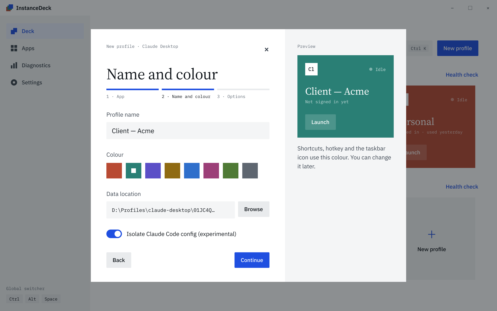 | 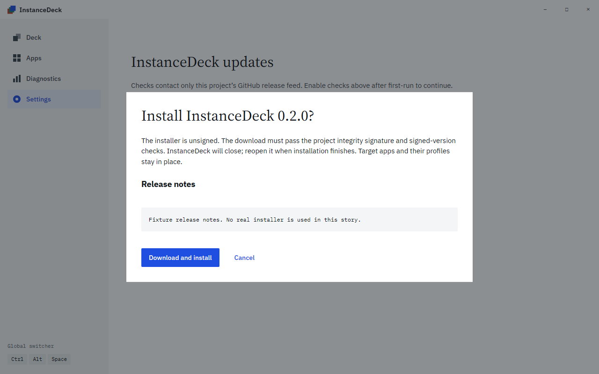 |
|           | 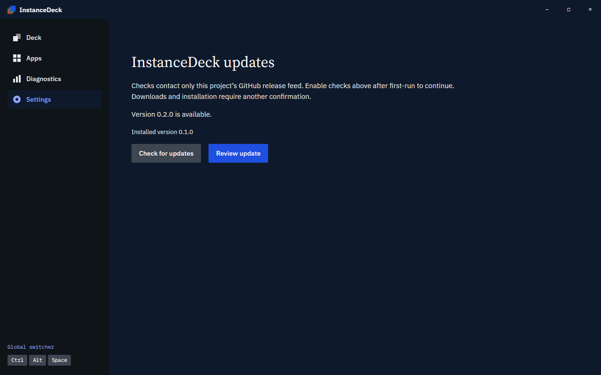        |

There is no dedicated updater Figma frame. The variants reuse the shared shell,
controls, palette and confirmation spacing. These captures use labelled
Storybook fixtures, not a published update. Offline verification of the locally
built own installer also passes with its signed version while Windows
Authenticode remains **NotSigned**. The private key was not transmitted.

A regression story reproduced an older manual request displaying its error after
switching update channels. Request generations now invalidate old manual and
automatic results on channel/consent changes or unmount; review state also
resets. The regression and installer-started state bring the library to **211
stories**. All **17 P7 stories** pass interaction and AA checks after the fix;
TypeScript passes. The local own-installer verifier rejects both tampering and a
signed-version mismatch:
[evidence](artifacts/p7/local-integrity-verification.json).

## P2 — Implementation and automated acceptance complete

The user's manual-verification deferral permits P3 to proceed. The desktop now
uses the required Radix modal primitives, per-view Zustand store and generated
tauri-specta request bindings. The binding export test starts no native window;
CI rejects generated-file drift. Keyboard create → launch → close and guarded
deletion checks pass in the explicitly simulated Storybook client. Fresh Radix
screenshots are retained in `artifacts/p2` alongside the existing Figma
comparisons below.

Validation: **161 stories / 10 suites**, zero axe WCAG 2.2 AA violations; **35
Rust tests**; TypeScript, lint and clippy with warnings denied all pass. The
targeted two desktop browser tests passed after the modal migration. Actual
native account, tray and keyboard verification remains deferred to the user. No
recipe was promoted from Community.

## P3 — Sign-in and app integrations (implementation complete)

Implemented journaled Claude snapshot sign-in, startup Resume/Restore, explicit
main-close consent, graceful-only closure and launch guards across UI, tray and
CLI. Unknown/ambiguous layouts, relocation markers, reparse points and low free
space stop the flow. Atomic no-replace renames retry at most ten times over
fifteen seconds. A same-volume capture is transferred opaquely by Windows into a
staged profile folder, supporting another drive while retaining the capture,
previous profile data and incomplete transfers. No app file contents are opened,
parsed, hashed or logged by production code. Journal history is retained.

The assistant's optional metadata hint observes a burst followed by three
seconds of quiet. Manual Finish is always available. Adoption never infers
account identity. Profile details offers Codex/in-profile guidance and an
explicit matches/mismatch report; recipe status remains Community. MCP copy
transfers only the regular `claude_desktop_config.json` file with a retained
destination backup. The experimental Claude Code isolation toggle remains per
profile.

The synthetic crash harness covers all durable states, three adoption steps, and
fourteen before/after-operation interruption points for both Resume and Restore.
SHA-256 fixture-tree comparisons prove original main data restoration. It also
covers partial adoption failure, an unexpected alternate live layout, low space,
relocation markers, journal-path tampering and the MCP allowlist. Native fixture
tests exercise opaque Windows copy, no-overwrite rename and notify metadata
activity under paths with spaces and non-ASCII characters.

Visual review caught native `[open]` selectors left over from the Radix
migration; dialog layout selectors now apply to Radix content. The browser check
asserts the Figma wizard's 812px two-column width. Updated screenshots retain
the same Figma references:

| Figma                                                     | Built shared view                       |
| --------------------------------------------------------- | --------------------------------------- |
| 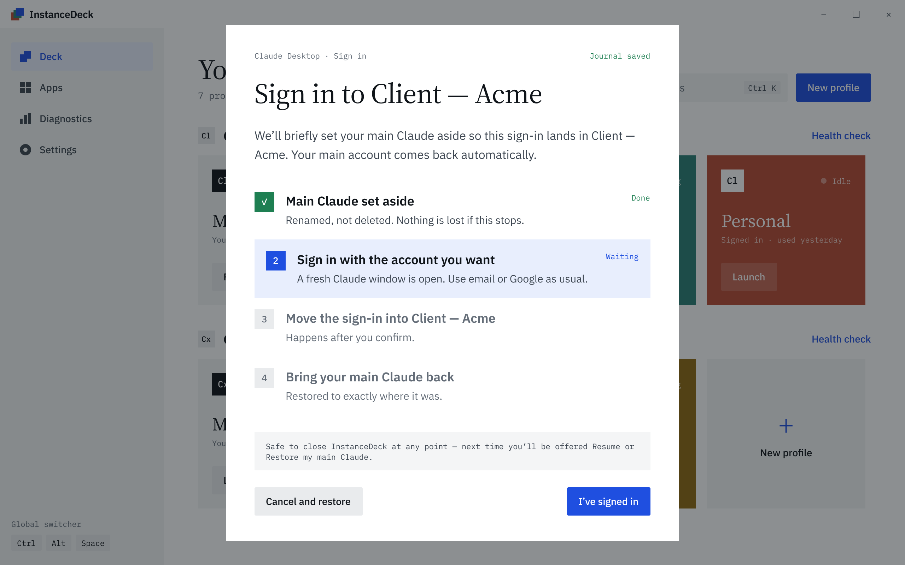 | 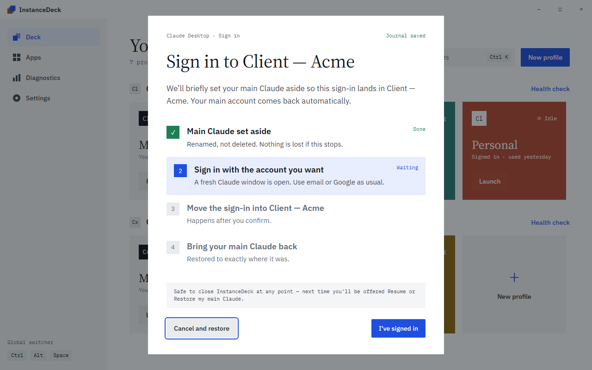    |
|      | 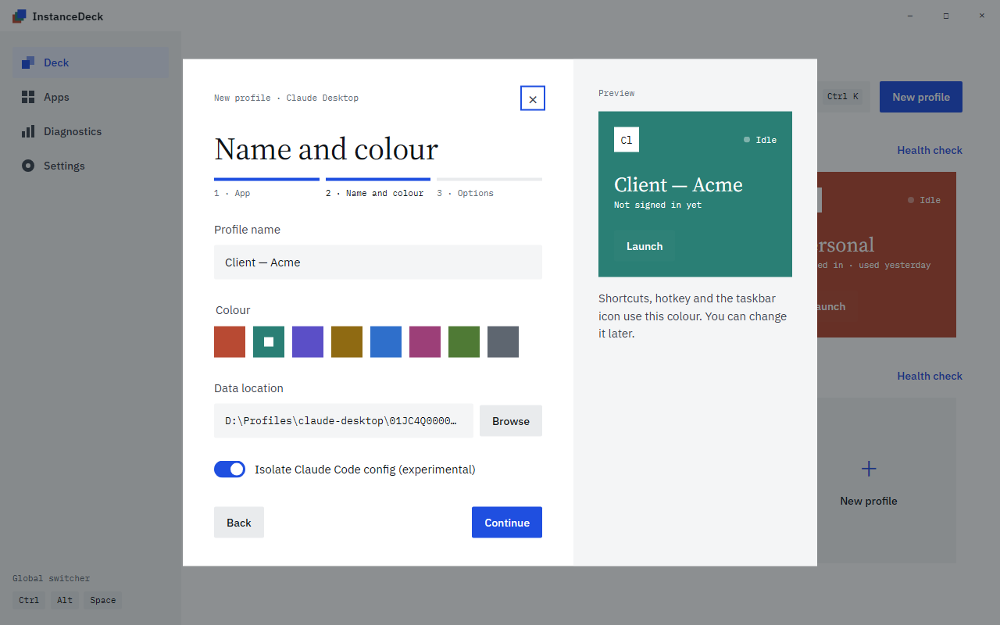 |

Additional captures: [consent](artifacts/p3/sign-in-consent.png),
[preflight failure](artifacts/p3/sign-in-consent-error.png),
[metadata hint](artifacts/p3/sign-in-metadata-hint.png),
[startup recovery](artifacts/p3/recovery-on-startup.png),
[MCP copy](artifacts/p3/profile-mcp.png),
[Codex guidance](artifacts/p3/codex-account-guidance.png),
[account warning](artifacts/p3/manual-account-warning.png).

Real account sign-in/recovery and callbackless/protocol-handler spikes remain
manual verification deferred to the user. No protocol handler was registered and
no real main/profile data was moved during this phase. The guides document the
implemented flow and distinguish synthetic evidence from account QA.

Validation: **47 Rust tests** passed; clippy with warnings denied, TypeScript
and lint pass. Core coverage is **89.89% lines** (1387/1543), above the 85%
gate; regions are 83.39% and functions 73.40%. These are not branch-coverage
figures. [Coverage report](artifacts/p3/core-coverage.json). The browser suite
passed all 13 tests before the added screenshot check; the final targeted
desktop/site run passes eight tests including that check. The final rerun passes
all **171 stories / 10 suites** with zero axe WCAG 2.2 AA violations, including
the corrected dialog layouts. P2's Windows
[CI](https://github.com/tanzir71/instancedeck/actions/runs/43591473177) and
[Pages build](https://github.com/tanzir71/instancedeck/actions/runs/43591473182)
also passed.

## P4 — Windows shell integration (implementation complete)

Started after P3's automated checks passed. Implemented pure shortcut identity
plans, safe Unicode shortcut names, canonical hotkey validation and duplicate
binding checks. Neutral profile ICOs use only project artwork and token colors.
The Windows shortcut adapter saves to a staged file, commits shell properties,
reloads with read/write mode to verify them, and retains an existing link before
activation. Three core shell tests and two Windows shell fixture tests pass. All
52 workspace Rust tests, clippy and generated-binding drift checks pass. The
out-of-context window monitor is implemented with PID/creation-time proof, 750ms
stability, relaunch properties, own profile icons and a 20s warning. It does not
read window titles or run hooks inside target processes. Snapshot reconciliation
and launch requests feed it; actual window/pinning QA remains deferred. Runtime
hotkeys, switcher, autostart, launcher argument forwarding and their UI controls
are implemented. Nothing has been added to the user's Desktop or Start Menu
during automated tests.

Tauri global shortcuts, autostart and window state use exact stable versions.
Hotkey conflicts preserve saved metadata and restore previous registrations.
Only an explicit startup preference edit changes autostart; unrelated privacy
edits still work if hotkey registration fails. Profile and settings mutations
are serialized with snapshot reconciliation. The switcher has its own hidden
window, keyboard filtering, Arrow/Enter activation and Escape dismissal even
during a pending launch. It hides on focus loss. Cold shortcut/autostart
launches keep the manager in the tray; subsequent launch requests use
single-instance forwarding. Window state stays in the manager's own state
directory.

Validation: **54 Rust tests**, clippy with warnings denied, TypeScript and lint
pass. All **17 browser tests** pass, including **182 stories** with axe checks,
the keyboard switcher flow, busy dismissal, shortcut failure and configured
wizard options. The **x64 release executable builds** without opening the app.
Core line coverage is **90.18%** (1524/1690), regions 83.91%, functions 73.85%.
[Coverage](artifacts/p4/core-coverage.json). The previous shortcut foundation's
[Windows CI](https://github.com/tanzir71/instancedeck/actions/runs/43593892203)
passed its native release build too.

Captures: [switcher](artifacts/p4/switcher.png),
[wizard options](artifacts/p4/wizard-options-configured.png),
[hotkey conflict](artifacts/p4/settings-hotkey-conflict.png),
[shortcut failure](artifacts/p4/profile-shortcut-error.png). The site now uses a
2560×1600 capture of the built shared Deck view instead of the permitted
temporary Figma export. Its profiles are explicitly example data, not real
accounts. [Capture metadata](artifacts/p4/product-capture.json).

Actual taskbar grouping, pin/relaunch, startup behavior and the DWM border spike
remain manual verification deferred to the user. DWM borders are not enabled.
The site stays unpublished until the remaining power-feature claims ship.

## P5 — Generic recipes and power features (implementation complete)

Added VS Code, Cursor, Chrome, Edge, Brave and Telegram Desktop recipes. All six
are Community with a deferred local-smoke-test reason and no invented version
reports. Sources are in packages/recipes/README.md. Telegram's paired workdir
arguments have exact process matching; Cursor reports partial isolation. The
site now generates all eight app pages and related links.

The Custom app editor validates direct executable paths, argument/environment
templates and an exact tracking marker, with a live resolved command preview.
Environment-only apps use PID/creation-time receipts from the actual spawned
process handle. PID reuse or singleton hand-offs grant no process authority.
Custom recipes remain local Experimental metadata with Unknown isolation.

Metadata import has a review step and preserves existing ids. It rejects
overlapping folders/hotkey conflicts and resets imported account confirmations,
last launch and sharing. Export contains no app data. Previous metadata and
exports are retained. Import creates no app folders.

Codex sessions sharing is off by default and explicitly opt-in. A synced,
versioned journal protects sessions-only junction changes. Private sessions are
retained without merging; Restore brings them back. Interrupted enable/disable
operations can resume or restore, block launch and removal, and retain retired
junctions outside the profile tree. Recycling rejects nested reparse points. No
transcript or authentication contents are read.

Dark theme uses the existing generated palette. Profile fills, white labels and
primary action fills stay fixed. Modal portals and the switcher share the saved
theme. New UI copy lives in en.json. The React checklist review covers debounced
read-only previews, cancelled stale results, explicit consent, keyboard access
and native error recovery.

Validation: **61 Rust tests**, warnings-denied clippy, TypeScript and lint pass.
All **21 browser tests** passed, including **194 stories** with axe WCAG 2.2 AA
checks. The twelve P5 stories also pass targeted interaction/a11y checks,
including actual save/sharing errors. Core coverage is **87.30% lines**
(1911/2189), regions 82.15%, functions 68.07%.
[Coverage](artifacts/p5/core-coverage.json). The x64 release executable builds
without opening the app. P4's
[Windows CI](https://github.com/tanzir71/instancedeck/actions/runs/43598876072)
passed. Native fixtures test junction creation/target checks, retained links and
byte-identical private/shared synthetic files under Unicode paths. No live Codex
history or other target app data was touched.

| Figma foundation                                            | Built variant                                |
| ----------------------------------------------------------- | -------------------------------------------- |
|           | 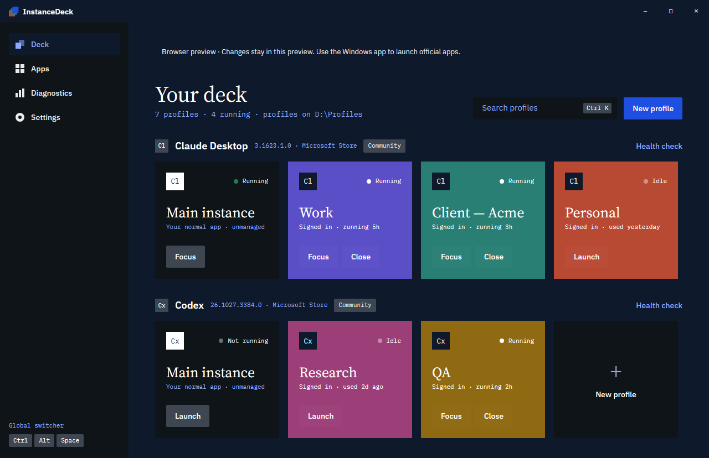     |
|  | 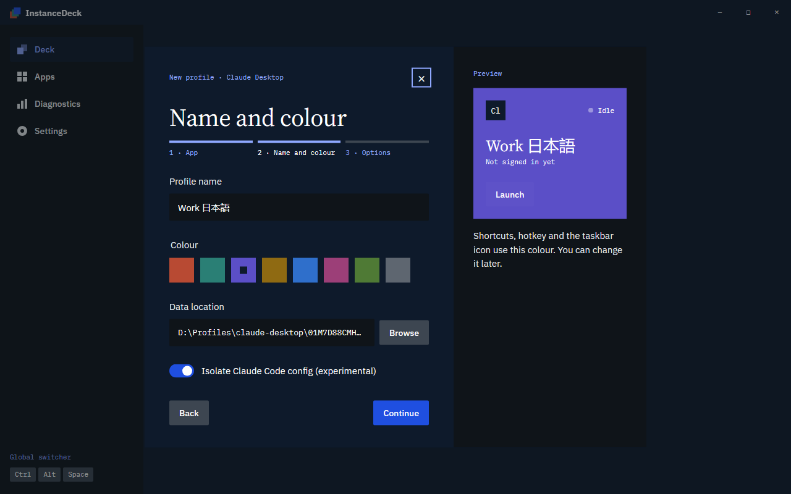 |

No dark/power-dialog Figma frame was supplied; these reuse its tokens, controls
and spacing as recorded in DECISIONS.md. Additional captures:
[dark settings](artifacts/p5/dark-settings.png),
[custom arguments](artifacts/p5/custom-arguments.png),
[environment-only editor](artifacts/p5/custom-environment.png),
[invalid recipe](artifacts/p5/custom-invalid.png),
[import review/error](artifacts/p5/import-review-error.png),
[opted-in sessions](artifacts/p5/shared-sessions.png).

Manual generic-app account smoke testing, live sharing, native dark-mode review,
pinning and the hardware/account matrix remain deferred to the user. No recipe
was promoted. P6 publication and P7 release engineering remain.

## P6 — Publication and acceptance complete

The site is live at <https://tanzir71.github.io/instancedeck/>. The
[Pages workflow](https://github.com/tanzir71/instancedeck/actions/runs/43600905447)
passed build, deployment and search notification. IndexNow accepted **24 URLs
with HTTP 202**; acceptance is not an indexing guarantee. Pages is configured
for the Astro workflow, and SITE_PUBLISH_ENABLED is now true.

All **25 site pages** build, including eight recipe pages. The packaged site has
**27 HTML files / 12 CSS files**, required footer credit/non-affiliation on
every HTML file, zero absolute-root anchors and zero shadow declarations.
[Packaged audit](artifacts/p6/packaged-site-audit.json). The main live route
audit reached all 24 sitemap URLs, mobile capture and the nested custom 404
successfully before checking the hosted Storybook theme.

Live Lighthouse: **97–100 Performance / 100 Accessibility / 100 Best Practices /
100 SEO** in all nine runs across home, Claude recipe and FAQ. LCP ≤1156ms; CLS
≤0.0087. [Live results](artifacts/p6/lighthouse-live-summary.json). The
refreshed local lab audit scores 100 in all four categories in all nine runs.
These are measured lab runs, not real-user performance guarantees.

Production verification caught Storybook's decorator overwriting the explicit
dark examples. Both themes are registered, dark examples are locked, selected
navigation contrast uses the existing deep token, and the marketing footer
retains fixed white text. All twelve power-feature interaction/axe checks pass
with true dark rendering. The packaged manager and dark preview also pass a real
browser footer/AA check, now required before Pages deployment.
[Packaged browser evidence](artifacts/p6/packaged-library-browser.json). The
pushed fix's deployment and the combined live audit are being followed through
while release engineering proceeds.

Figma section-by-section comparisons remain in the historical P6 table below.
Fresh published captures: [1440 home](artifacts/p6/live-home-desktop.png) and
[390 home](artifacts/p6/live-home-mobile.png). Mobile matches the abridged Figma
frame and the built product screenshot replaces the initial design export. P7
release engineering remains; native/account verification remains deferred.

## P0 — Scaffold and tooling (complete)

Started 2026-11-14 on Windows 11 25H2, build 26200, x64. Initial workspace:
handover, AGENTS.md and Figma exports only; no Git repository.

- Read HANDOVER.md, design/README.md and tokens.json.
- Read live Figma components (`151:2297`), Deck (`155:2321`) and foundation
  variables (`154:2306`), session `79905340-1e2a-4935-b073-fed9959be449`.
- Node 24.22.2, pnpm 10.33.2, Rust 1.97.0; VS 2022 C++ tools available.

Implemented:

- pnpm/Turborepo workspaces, exact dependency pins and lockfiles; Rust workspace
  with platform/core/CLI boundaries and Tauri 2 Windows shell.
- Style Dictionary generates CSS variables and TypeScript constants directly
  from `design/tokens.json`; fonts and SVG assets are local.
- Shared Button variants, Logo, empty Deck and Astro scaffold/footer; all
  shipped components/states have Storybook stories.
- ESLint, Prettier, stylelint flat-color/no-shadow/no-stroke rules, rustfmt,
  warnings-denied clippy and a Windows CI workflow.
- `pnpm test` now includes contrast checks, both application smoke tests and
  every Storybook interaction/accessibility test. Browser tests check that site
  SVGs really load; visual inspection found and corrected an Astro SVG import
  issue.

Local evidence (2026-11-14):

- All three required development commands started on Windows 11: native WebView2
  empty Deck, Storybook at port 6006, Astro under `/instancedeck/` at port 4321.
- `pnpm typecheck`, `pnpm lint`, `pnpm build`, `pnpm build:storybook`: passed.
- `cargo test --workspace`: passed (scaffold has no Rust domain tests yet).
- `cargo clippy --workspace -- -D warnings`: passed.
- `pnpm build:desktop`: passed; produced an x64 native executable.
- `pnpm test`: all 4 browser tests passed, including all 20 Storybook stories
  across 5 suites, the corrected site SVGs and all eight OnColor palette cases.
- [Windows CI](https://github.com/tanzir71/instancedeck/actions/runs/43575723466)
  passed all steps, including native x64 release compilation (9m28s).
- [Final tooling validation](https://github.com/tanzir71/instancedeck/actions/runs/43576518592)
  passed every step for the path-safe generator and stricter CSS lint rules.
  Negative local fixtures also confirmed logical borders, gradients and shadows
  are rejected. P0's required development commands and Windows CI gate passed.

Visual evidence (Figma | built):

| Reference                                       | Built                                               |
| ----------------------------------------------- | --------------------------------------------------- |
|         |  |
| 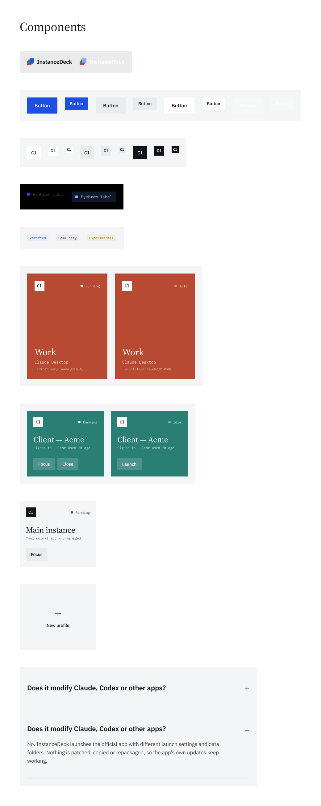   |           |
| 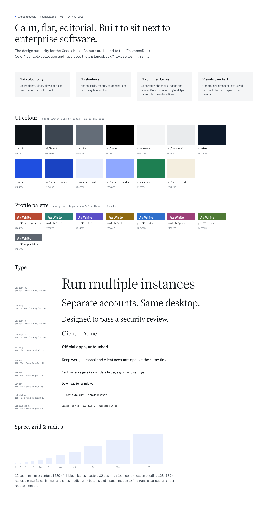 |    |

[Native Windows screenshot](artifacts/p0/native-empty.jpg) ·
[Site scaffold screenshot](artifacts/p0/site-scaffold.png) ·
[Storybook Button](http://127.0.0.1:6006/?path=/story/components-button--primary)
·
[All palette cases](http://127.0.0.1:6006/?path=/story/components-button--profile-palette)

Known limits: this is the empty scaffold, with native window decoration. The
populated Deck and custom title bar are P2; the complete landing site is P6. One
evidence-backed accessibility deviation from the Figma OnColor translucency is
recorded in `DECISIONS.md`.

## P1 — Engine core and Windows CLI (complete)

Implemented:

- Rust-generated recipe schema, strict loader/semantic validation and template
  expansion. Claude Desktop and Codex recipes remain Community; upstream
  provenance is separate from local process testing.
- ULID profiles, versioned/migrated metadata, locked atomic writes and retained
  metadata backups. Rename preserves paths; remove keeps all profile data.
- Runtime WinRT PackageManager discovery, registry uninstall views, known paths
  and versioned legacy Squirrel paths. No WindowsApps path is hard-coded.
- Direct Unicode launch and one package-context fallback with a UTF-16LE BOM
  wrapper and quoted, encoded arguments/environment values.
- Exact normalized argument matching, descendant metadata, creation-time checks
  against PID reuse, manager exclusion, bounded launch tracking, WM_CLOSE and an
  eight-second grace period before explicitly confirmed force close.
- Structured launch logs and redacted metadata-only doctor output. CLI: apps;
  profiles list/create/rename/remove; launch; close; plan; doctor;
  recipe-schema.
- CI now checks schema drift and core line coverage ≥85%. Runtime profile
  folders are excluded from Git and CI uploads.

Evidence:

- All **27 Rust tests passed** across the full workspace: 20 core, 4 Windows and
  3 CLI. Warnings-denied Clippy, schema drift and repository lint checks passed.
- Core coverage: **96.92% lines**, **92.16% regions**, **90.00% functions**.
  [Coverage JSON](artifacts/p1/core-coverage.json).
- The real Windows wrapper fixture passed with spaces, Japanese, Zoë,
  apostrophes, percent signs, ampersands and exclamation marks.
- [Live smoke proof](artifacts/p1/live-smoke.json), 2026-11-14 09:01 UTC on
  Windows 11 build 26200 x64:

| App            | Discovered MSIX version | Simultaneous result                    |
| -------------- | ----------------------- | -------------------------------------- |
| Claude Desktop | 5.11492.5.0             | Main app + 2 new profile process trees |
| Codex          | 26.1106.6628.0          | Main app + 2 new profile process trees |

All four managed process trees were nonempty and disjoint from one another and
both main app trees. This verifies concurrent process isolation, **not account
identity**. No credential files were read and no sign-in was automated.

Known issues/limits:

- All four test profiles retained background processes after WM_CLOSE and the
  eight-second grace period. The CLI correctly returned StillRunning and
  required explicit force confirmation. With Tanzir's approval, only those QA
  profiles were force-closed.
  [Final cleanup proof](artifacts/p1/final-cleanup.json) shows all four stopped,
  both main apps running and every profile directory retained.
- Direct launch and forced live MSIX fallback passed on both installed versions.
  [Fallback proof](artifacts/p1/package-context-smoke.json) and
  [scoped cleanup](artifacts/p1/package-context-cleanup.json). The live test
  found Claude's application ID is Claude; Codex's is App. Recipes now reflect
  that.
- Different-account QA and Claude snapshot sign-in belong to P3/manual QA. No
  recipe has been promoted to Verified. P2 is in progress; P3–P7 are not
  complete.

## P2 — Desktop UI (in progress)

Implemented:

- Shared controls, monograms, badges, status dots, profile/main/add cards,
  grouped Deck, search, three-step wizard and profile side panel.
- Apps, metadata-only Diagnostics, Settings, first-run preferences, About, typed
  force/remove/Recycle Bin confirmations, sign-in and recovery views.
- Tauri requests call the P1 engine. Profile edits cannot redirect stored paths
  or claim an account is signed in. Destructive requests require the exact
  profile name; recycling also requires stopped processes and the launch lock.
- Windows Recycle Bin and Explorer operations sit behind a core trait. A fake
  adapter verifies rejection, stopped-state gating, failed recycling retaining
  metadata and successful dispatch without touching real data.
- Versioned settings with durable writes and retained backups; grouped native
  tray menu, close-to-tray, single manager instance and live status events.
- Browser preview is explicitly labelled and holds changes only in memory.
  Process simulation is enabled only in Storybook test fixtures.

Evidence so far:

- `pnpm typecheck` and `pnpm lint`: passed for the desktop implementation. The
  full workspace's 32 Rust tests passed after the final wizard ID change; two
  further native recycle-only fixture/guard tests passed. Warnings-denied
  all-target Clippy passed. The x64 native release executable compiled.
- Core line coverage: **94.49%** (994/1052); regions **89.15%**, functions
  **83.45%**. [Coverage JSON](artifacts/p2/core-coverage.json). The ≥85% CI
  threshold applies to lines; branch coverage is not measured.
- All **157 Storybook stories** passed axe and the a11y addon after adding the
  marketing and documentation components. All six original browser tests passed,
  including keyboard create → launch → close and the guarded deletion dialog.
  This keyboard evidence uses a simulated process adapter.
- Real native WebView2 boot and first-run dialog were observed. Native UI
  control was stopped with Escape before the native keyboard/tray check; that
  final gate remains open. No P2 target profiles have been launched.
- P1's
  [Windows CI](https://github.com/tanzir71/instancedeck/actions/runs/43580584572)
  passed all steps, including coverage and the x64 release build.
- [Desktop and component milestone CI](https://github.com/tanzir71/instancedeck/actions/runs/43585841035)
  passed every Windows check, including the real recycle-only fixture, all Rust
  tests, core coverage and the native x64 release build.

Visual comparisons (Figma | built Storybook view):

| Figma                                                  | Built                                        |
| ------------------------------------------------------ | -------------------------------------------- |
|                      | 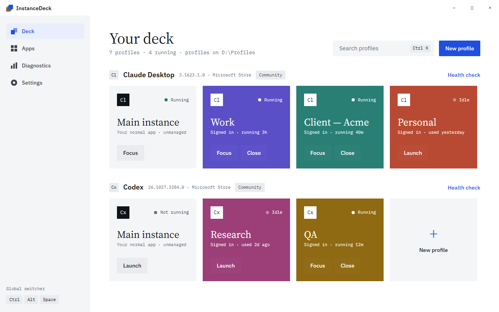               |
|        |  |
|  |   |

Other screens: [Profile](artifacts/p2/profile.png),
[Apps](artifacts/p2/apps.png), [Diagnostics](artifacts/p2/diagnostics.png),
[Settings](artifacts/p2/settings.png), [First run](artifacts/p2/first-run.png),
[Recovery](artifacts/p2/recovery.png), [Empty](artifacts/p2/empty.png),
[Loading](artifacts/p2/loading.png), [Error](artifacts/p2/error.png),
[Keyboard flow](artifacts/p2/keyboard-flow.png).

The comparison uses the supplied Figma example profiles, versions and account
labels only as Storybook fixtures. Runtime counts, versions and account-state
labels come from the engine; no real account identity has been certified.
Accessibility deviations and phase-dependent controls are recorded in
`DECISIONS.md`. P2 is not marked complete until native verification is finished.

## P6 — Landing site (in progress, parallel phase)

Implemented in the shared UI package:

- Live Figma desktop/mobile contexts supply all eleven home sections: header,
  hero fan, compatibility strip, pillars, steps/product image, use cases,
  Claude/Codex illustrations, security band, native FAQ rows, CTA and footer.
- Mobile follows the shorter Figma frame. All colors come from generated tokens.
  The full mandatory non-affiliation statement and both tanziro.com links remain
  visible. Signed-release claims are conditional.
- Shared documentation layout, breadcrumbs, compatibility cards and comparison
  table. Marketing components have responsive and keyboard stories.
- Real browser keyboard tests passed for menu focus containment, Escape/focus
  return, and native FAQ Enter/Space toggling. Mobile document width is exactly
  390px at a 390px viewport. No horizontal overflow was observed.
- All 157 current stories passed across ten suites. Repository lint, all three
  TypeScript checks and warnings-denied Rust Clippy passed. The React checklist
  review keeps site rendering static and the menu enhancement separate from
  React hydration; FAQ behavior uses native details/summary.
- `pnpm test` passed all eight browser tests (including all stories and palette
  contrast checks). `pnpm build` and `pnpm build:storybook` passed.

Visual comparisons (Figma | built Storybook sections):

| Figma                                                                  | Built                                         |
| ---------------------------------------------------------------------- | --------------------------------------------- |
|                     |             |
|                         |                 |
|             |          |
|                   |           |
|         |          |
| 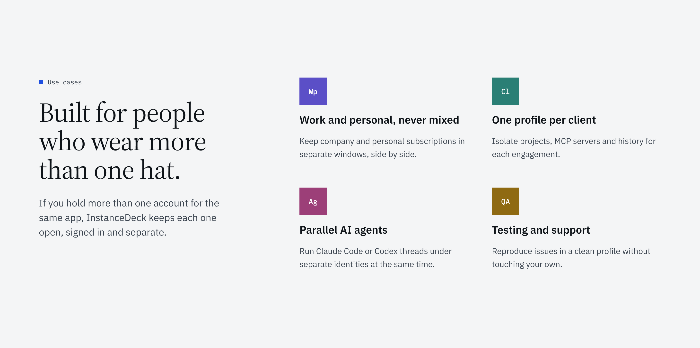              |       |
| 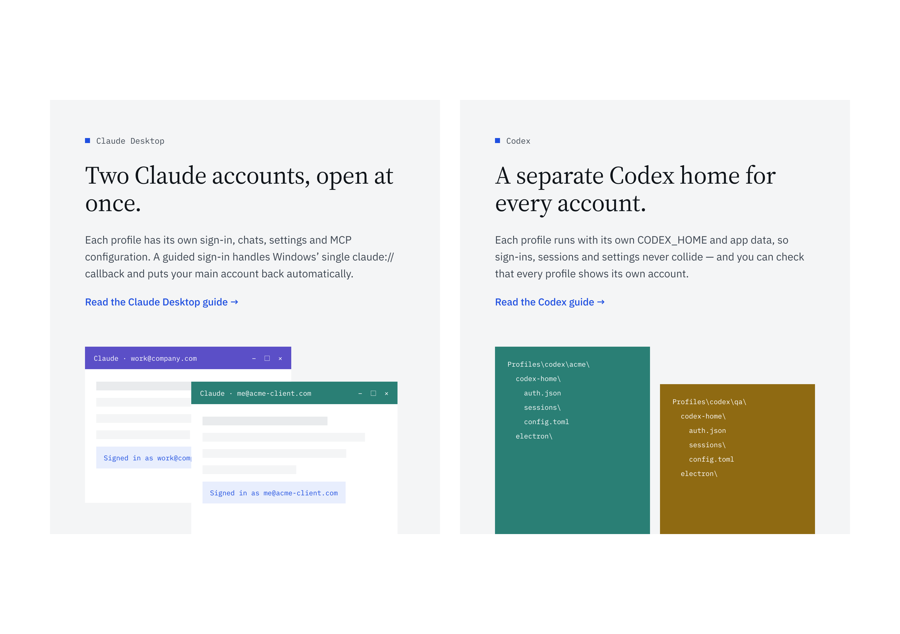 |       |
| 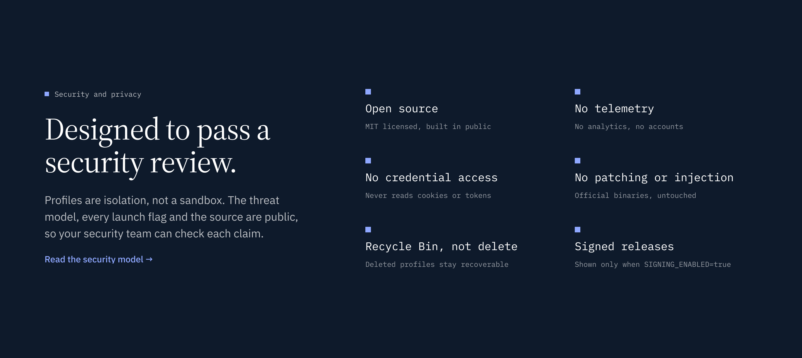                |         |
| 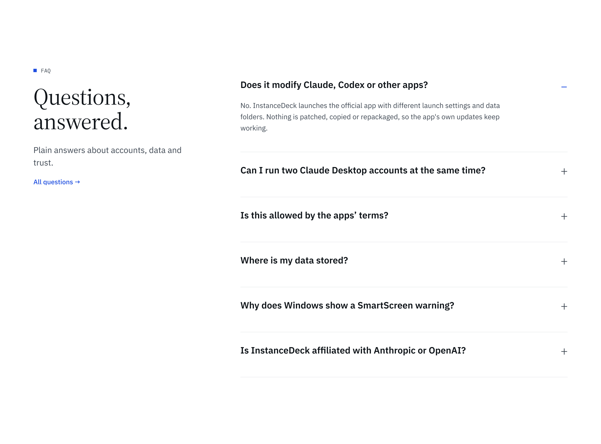                          | 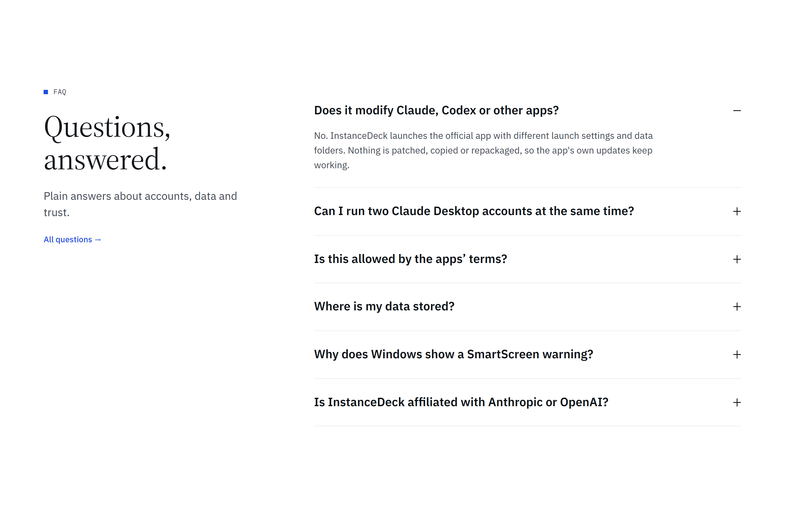                  |
| 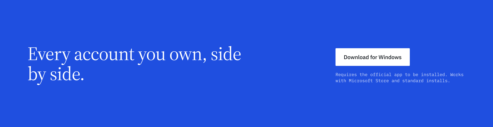                          |                   |
|                     |             |
|                          | 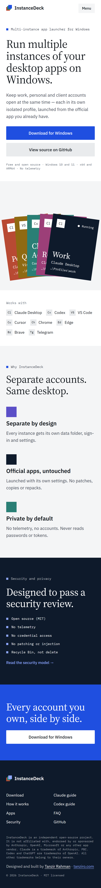 |

[Measured section geometry](artifacts/p6/foundation-layout.json). These are
component screenshots, not a deployed site. The product image is the supplied
Figma export as explicitly permitted by design/README.md until P2 ships; it will
then be replaced with a built app screenshot.

Astro implementation and production evidence:

- **19 HTML pages** now build: every §9.1 route, the two existing recipe pages,
  Docs, Contributing, MIT license and Trademarks. Additional recipe pages
  generate automatically when the P5 recipes ship. Guides distinguish current
  behavior from the unfinished sign-in, shell and shared-history features.
- Download, Changelog and home version metadata use a single cached public
  GitHub Releases fetch at build time. No release is fabricated, and an API
  error fails the build. No browser request to GitHub is needed.
- Unique metadata, canonical URLs, visible breadcrumbs and typed JSON-LD,
  nineteen Satori/Resvg OG images, Git-dated sitemap, llms.txt, local fonts,
  WebP product image, .nojekyll and an Astro-generated hashed CSP.
- Sticky header and the mobile menu use **473 bytes gzipped** of JavaScript. No
  React islands or third-party scripts are sent to the home page.
- All **11 browser tests passed**, including the 19-page metadata/link/AA audit,
  mobile home and app/FAQ/comparison overflow checks. **162 stories** passed
  across ten suites, including the mobile-omitted sections and scrolled header
  state. Lint and TypeScript checks passed.
- Lighthouse: **100 Performance / 100 Accessibility / 100 Best Practices / 100
  SEO** on home, Claude recipe and FAQ in all nine runs. LCP ≤810ms and CLS 0.
  [Results](artifacts/p6/lighthouse-summary.json). These are local mobile lab
  results, not a claim about real-user or deployed performance.
- The packaged artifact has **21 HTML files**, including Storybook's manager and
  preview, with required credit/non-affiliation, no absolute-root anchors and
  zero box-shadow declarations across eleven CSS files.
  [Artifact audit](artifacts/p6/packaged-site-audit.json).
  [Packaged browser check](artifacts/p6/packaged-library-browser.json).
- Pages workflow builds, audits, packages and uploads the site. Deployment is
  gated by SITE_PUBLISH_ENABLED until the desktop feature claims are true. The
  post-deploy IndexNow script verifies its project-scoped key and sitemap before
  submission. Publication and a successful live ping remain unverified.

Built Astro screenshots: [1440 home](artifacts/p6/home-desktop-browser.png),
[390 home](artifacts/p6/home-mobile-browser.png),
[mobile app guide](artifacts/p6/apps-claude-desktop-mobile.png),
[mobile FAQ](artifacts/p6/faq-mobile.png),
[mobile comparison](artifacts/p6/compare-parall-for-windows-mobile.png). The
eleven `artifacts/p6/site-*.png` files capture each actual built section, in
addition to the component comparisons above.

The
[Pages build](https://github.com/tanzir71/instancedeck/actions/runs/43588371850)
passed on Ubuntu, including Lighthouse and packaging. Deploy/IndexNow were
correctly skipped by the publication gate. The Windows job in
[CI](https://github.com/tanzir71/instancedeck/actions/runs/43588371901) passed
all steps for the site milestone. A further targeted browser regression passed
for a missing nested URL: custom 404 navigation uses the configured absolute
project URL, so links remain correct when GitHub serves 404.html at an arbitrary
request path.

Remaining: live Pages deployment/IndexNow, P5's additional recipe entries and
related-app links, and replacing the permitted product design image when P2
ships. This historical P6 entry predates the completed P3–P5 implementation
above. Live publication and P7 release engineering remain. Native/manual QA is
explicitly deferred by the user; no desktop control will be resumed.
