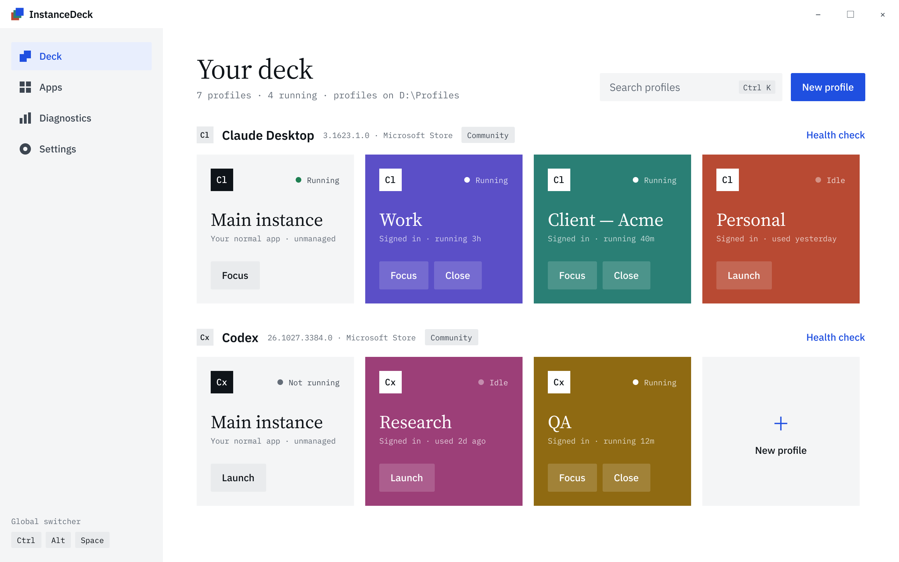
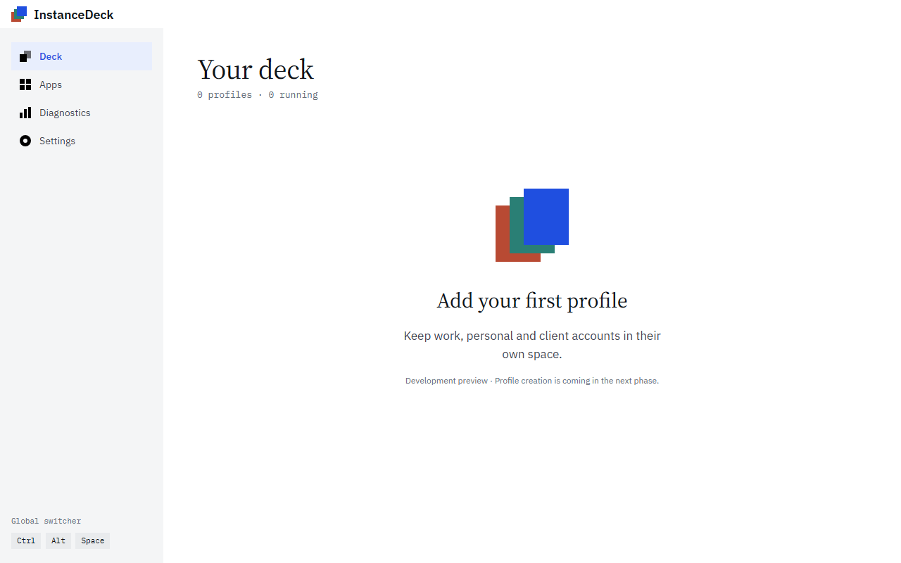
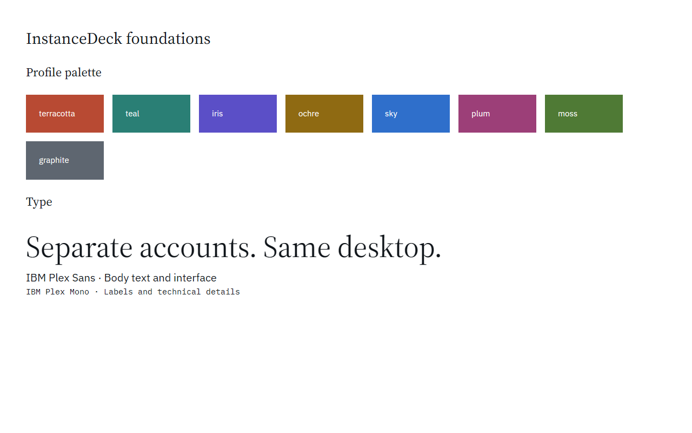
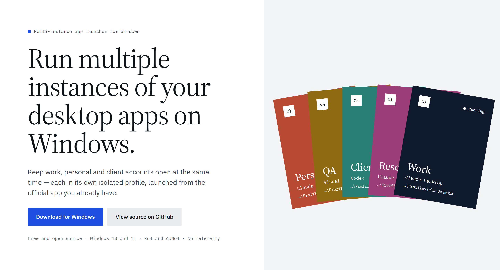
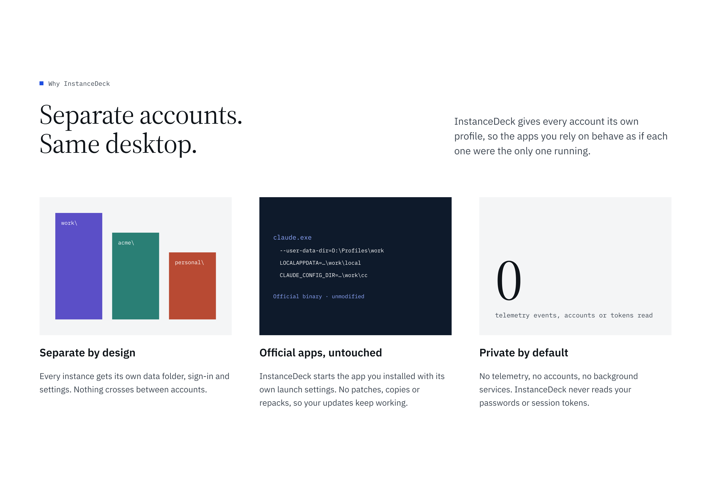
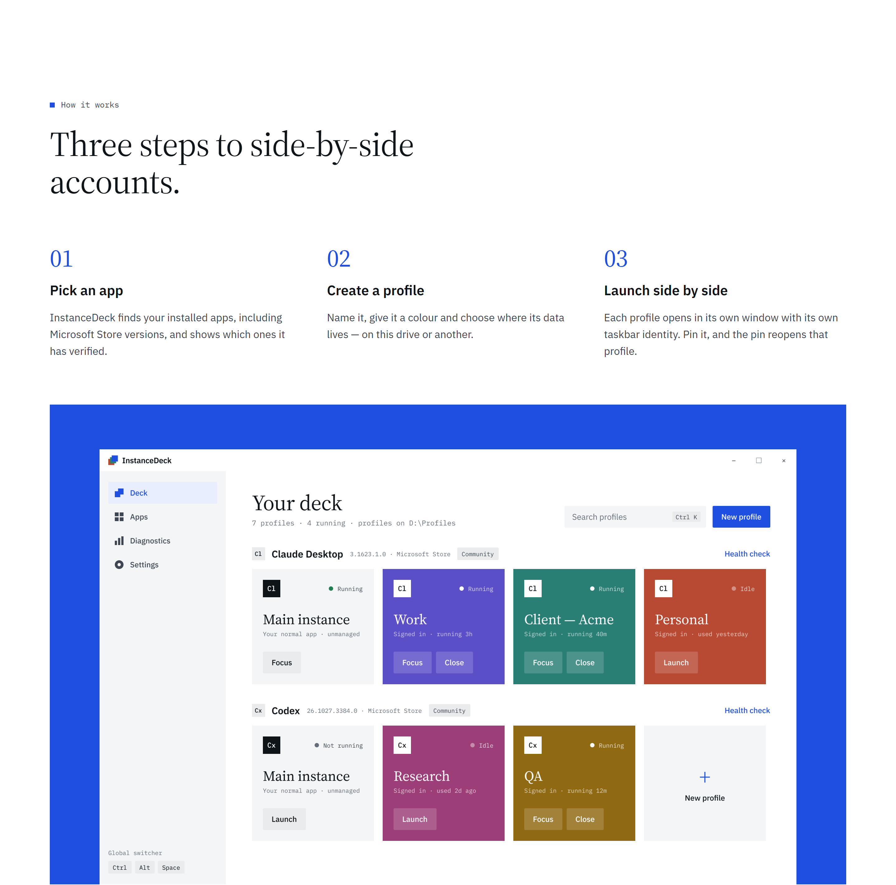
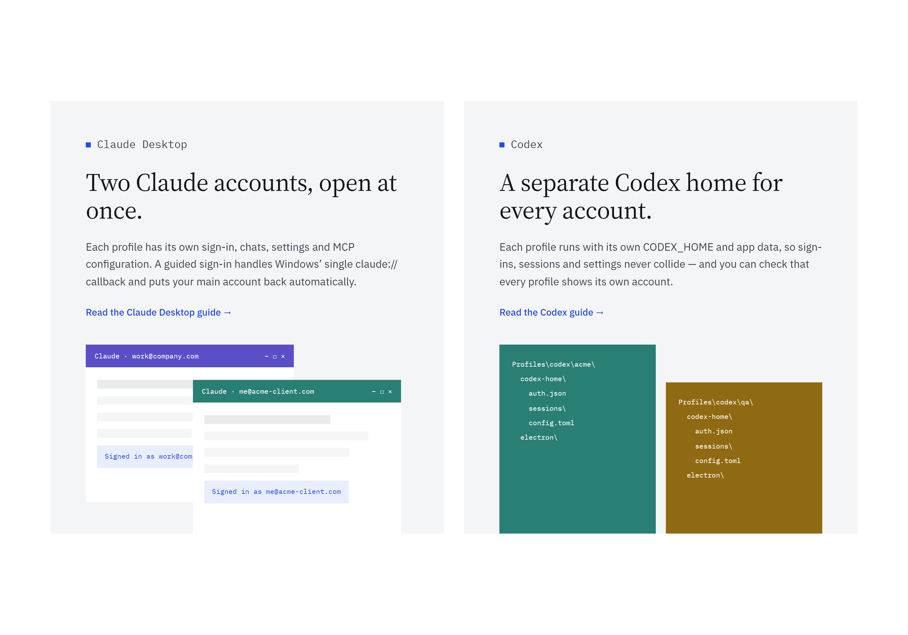
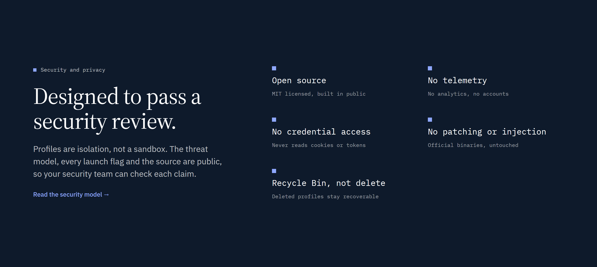
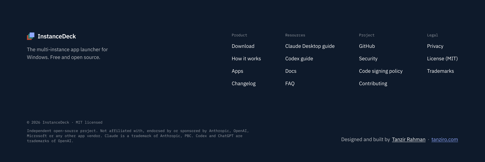
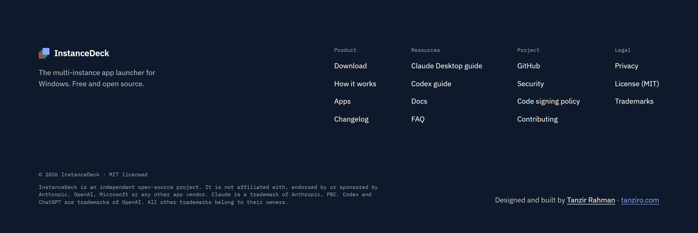

# Progress

## P0 — Scaffold and tooling (complete)

Started 2026-11-14 on Windows 11 25H2, build 26200, x64. Initial workspace:
handover, AGENTS.md and Figma exports only; no Git repository.

- Read HANDOVER.md, design/README.md and tokens.json.
- Read live Figma components (`151:2297`), Deck (`155:2321`) and foundation
  variables (`154:2306`), session `79905340-1e2a-4935-b073-fed9959be449`.
- Node 24.22.2, pnpm 10.33.2, Rust 1.97.0; VS 2022 C++ tools available.

Implemented:

- pnpm/Turborepo workspaces, exact dependency pins and lockfiles; Rust workspace
  with platform/core/CLI boundaries and Tauri 2 Windows shell.
- Style Dictionary generates CSS variables and TypeScript constants directly
  from `design/tokens.json`; fonts and SVG assets are local.
- Shared Button variants, Logo, empty Deck and Astro scaffold/footer; all
  shipped components/states have Storybook stories.
- ESLint, Prettier, stylelint flat-color/no-shadow/no-stroke rules, rustfmt,
  warnings-denied clippy and a Windows CI workflow.
- `pnpm test` now includes contrast checks, both application smoke tests and
  every Storybook interaction/accessibility test. Browser tests check that site
  SVGs really load; visual inspection found and corrected an Astro SVG import
  issue.

Local evidence (2026-11-14):

- All three required development commands started on Windows 11: native WebView2
  empty Deck, Storybook at port 6006, Astro under `/instancedeck/` at port 4321.
- `pnpm typecheck`, `pnpm lint`, `pnpm build`, `pnpm build:storybook`: passed.
- `cargo test --workspace`: passed (scaffold has no Rust domain tests yet).
- `cargo clippy --workspace -- -D warnings`: passed.
- `pnpm build:desktop`: passed; produced an x64 native executable.
- `pnpm test`: all 4 browser tests passed, including all 20 Storybook stories
  across 5 suites, the corrected site SVGs and all eight OnColor palette cases.
- [Windows CI](https://github.com/tanzir71/instancedeck/actions/runs/43575723466)
  passed all steps, including native x64 release compilation (9m28s).
- [Final tooling validation](https://github.com/tanzir71/instancedeck/actions/runs/43576518592)
  passed every step for the path-safe generator and stricter CSS lint rules.
  Negative local fixtures also confirmed logical borders, gradients and shadows
  are rejected. P0's required development commands and Windows CI gate passed.

Visual evidence (Figma | built):

| Reference                                       | Built                                               |
| ----------------------------------------------- | --------------------------------------------------- |
|         |  |
|    |           |
|  |    |

[Native Windows screenshot](artifacts/p0/native-empty.jpg) ·
[Site scaffold screenshot](artifacts/p0/site-scaffold.png) ·
[Storybook Button](http://127.0.0.1:6006/?path=/story/components-button--primary)
·
[All palette cases](http://127.0.0.1:6006/?path=/story/components-button--profile-palette)

Known limits: this is the empty scaffold, with native window decoration. The
populated Deck and custom title bar are P2; the complete landing site is P6. One
evidence-backed accessibility deviation from the Figma OnColor translucency is
recorded in `DECISIONS.md`.

## P1 — Engine core and Windows CLI (complete)

Implemented:

- Rust-generated recipe schema, strict loader/semantic validation and template
  expansion. Claude Desktop and Codex recipes remain Community; upstream
  provenance is separate from local process testing.
- ULID profiles, versioned/migrated metadata, locked atomic writes and retained
  metadata backups. Rename preserves paths; remove keeps all profile data.
- Runtime WinRT PackageManager discovery, registry uninstall views, known paths
  and versioned legacy Squirrel paths. No WindowsApps path is hard-coded.
- Direct Unicode launch and one package-context fallback with a UTF-16LE BOM
  wrapper and quoted, encoded arguments/environment values.
- Exact normalized argument matching, descendant metadata, creation-time checks
  against PID reuse, manager exclusion, bounded launch tracking, WM_CLOSE and an
  eight-second grace period before explicitly confirmed force close.
- Structured launch logs and redacted metadata-only doctor output. CLI: apps;
  profiles list/create/rename/remove; launch; close; plan; doctor;
  recipe-schema.
- CI now checks schema drift and core line coverage ≥85%. Runtime profile
  folders are excluded from Git and CI uploads.

Evidence:

- All **27 Rust tests passed** across the full workspace: 20 core, 4 Windows and
  3 CLI. Warnings-denied Clippy, schema drift and repository lint checks passed.
- Core coverage: **96.92% lines**, **92.16% regions**, **90.00% functions**.
  [Coverage JSON](artifacts/p1/core-coverage.json).
- The real Windows wrapper fixture passed with spaces, Japanese, Zoë,
  apostrophes, percent signs, ampersands and exclamation marks.
- [Live smoke proof](artifacts/p1/live-smoke.json), 2026-11-14 09:01 UTC on
  Windows 11 build 26200 x64:

| App            | Discovered MSIX version | Simultaneous result                    |
| -------------- | ----------------------- | -------------------------------------- |
| Claude Desktop | 5.11492.5.0             | Main app + 2 new profile process trees |
| Codex          | 26.1106.6628.0          | Main app + 2 new profile process trees |

All four managed process trees were nonempty and disjoint from one another and
both main app trees. This verifies concurrent process isolation, **not account
identity**. No credential files were read and no sign-in was automated.

Known issues/limits:

- All four test profiles retained background processes after WM_CLOSE and the
  eight-second grace period. The CLI correctly returned StillRunning and
  required explicit force confirmation. With Tanzir's approval, only those QA
  profiles were force-closed.
  [Final cleanup proof](artifacts/p1/final-cleanup.json) shows all four stopped,
  both main apps running and every profile directory retained.
- Direct launch and forced live MSIX fallback passed on both installed versions.
  [Fallback proof](artifacts/p1/package-context-smoke.json) and
  [scoped cleanup](artifacts/p1/package-context-cleanup.json). The live test
  found Claude's application ID is Claude; Codex's is App. Recipes now reflect
  that.
- Different-account QA and Claude snapshot sign-in belong to P3/manual QA. No
  recipe has been promoted to Verified. P2 is in progress; P3–P7 are not
  complete.

## P2 — Desktop UI (in progress)

Implemented:

- Shared controls, monograms, badges, status dots, profile/main/add cards,
  grouped Deck, search, three-step wizard and profile side panel.
- Apps, metadata-only Diagnostics, Settings, first-run preferences, About, typed
  force/remove/Recycle Bin confirmations, sign-in and recovery views.
- Tauri requests call the P1 engine. Profile edits cannot redirect stored paths
  or claim an account is signed in. Destructive requests require the exact
  profile name; recycling also requires stopped processes and the launch lock.
- Windows Recycle Bin and Explorer operations sit behind a core trait. A fake
  adapter verifies rejection, stopped-state gating, failed recycling retaining
  metadata and successful dispatch without touching real data.
- Versioned settings with durable writes and retained backups; grouped native
  tray menu, close-to-tray, single manager instance and live status events.
- Browser preview is explicitly labelled and holds changes only in memory.
  Process simulation is enabled only in Storybook test fixtures.

Evidence so far:

- `pnpm typecheck` and `pnpm lint`: passed for the desktop implementation. The
  full workspace's 32 Rust tests passed after the final wizard ID change; two
  further native recycle-only fixture/guard tests passed. Warnings-denied
  all-target Clippy passed. The x64 native release executable compiled.
- Core line coverage: **94.49%** (994/1052); regions **89.15%**, functions
  **83.45%**. [Coverage JSON](artifacts/p2/core-coverage.json). The ≥85% CI
  threshold applies to lines; branch coverage is not measured.
- All **157 Storybook stories** passed axe and the a11y addon after adding the
  marketing and documentation components. All six original browser tests passed,
  including keyboard create → launch → close and the guarded deletion dialog.
  This keyboard evidence uses a simulated process adapter.
- Real native WebView2 boot and first-run dialog were observed. Native UI
  control was stopped with Escape before the native keyboard/tray check; that
  final gate remains open. No P2 target profiles have been launched.
- P1's
  [Windows CI](https://github.com/tanzir71/instancedeck/actions/runs/43580584572)
  passed all steps, including coverage and the x64 release build.
- [Desktop and component milestone CI](https://github.com/tanzir71/instancedeck/actions/runs/43585841035)
  passed every Windows check, including the real recycle-only fixture, all Rust
  tests, core coverage and the native x64 release build.

Visual comparisons (Figma | built Storybook view):

| Figma                                                  | Built                                        |
| ------------------------------------------------------ | -------------------------------------------- |
|                      |                |
|        |  |
|  |   |

Other screens: [Profile](artifacts/p2/profile.png),
[Apps](artifacts/p2/apps.png), [Diagnostics](artifacts/p2/diagnostics.png),
[Settings](artifacts/p2/settings.png), [First run](artifacts/p2/first-run.png),
[Recovery](artifacts/p2/recovery.png), [Empty](artifacts/p2/empty.png),
[Loading](artifacts/p2/loading.png), [Error](artifacts/p2/error.png),
[Keyboard flow](artifacts/p2/keyboard-flow.png).

The comparison uses the supplied Figma example profiles, versions and account
labels only as Storybook fixtures. Runtime counts, versions and account-state
labels come from the engine; no real account identity has been certified.
Accessibility deviations and phase-dependent controls are recorded in
`DECISIONS.md`. P2 is not marked complete until native verification is finished.

## P6 — Landing site (in progress, parallel phase)

Implemented in the shared UI package:

- Live Figma desktop/mobile contexts supply all eleven home sections: header,
  hero fan, compatibility strip, pillars, steps/product image, use cases,
  Claude/Codex illustrations, security band, native FAQ rows, CTA and footer.
- Mobile follows the shorter Figma frame. All colors come from generated tokens.
  The full mandatory non-affiliation statement and both tanziro.com links remain
  visible. Signed-release claims are conditional.
- Shared documentation layout, breadcrumbs, compatibility cards and comparison
  table. Marketing components have responsive and keyboard stories.
- Real browser keyboard tests passed for menu focus containment, Escape/focus
  return, and native FAQ Enter/Space toggling. Mobile document width is exactly
  390px at a 390px viewport. No horizontal overflow was observed.
- All 157 current stories passed across ten suites. Repository lint, all three
  TypeScript checks and warnings-denied Rust Clippy passed. The React checklist
  review keeps site rendering static and the menu enhancement separate from
  React hydration; FAQ behavior uses native details/summary.
- `pnpm test` passed all eight browser tests (including all stories and palette
  contrast checks). `pnpm build` and `pnpm build:storybook` passed.

Visual comparisons (Figma | built Storybook sections):

| Figma                                                                  | Built                                         |
| ---------------------------------------------------------------------- | --------------------------------------------- |
|                     |             |
|                         |                 |
|             |          |
|                   |           |
|         |          |
|               |       |
|  |       |
|                 |         |
|                           |                   |
|                           |                   |
|                     |             |
|                          |  |

[Measured section geometry](artifacts/p6/foundation-layout.json). These are
component screenshots, not a deployed site. The product image is the supplied
Figma export as explicitly permitted by design/README.md until P2 ships; it will
then be replaced with a built app screenshot.

Astro implementation and production evidence:

- **19 HTML pages** now build: every §9.1 route, the two existing recipe pages,
  Docs, Contributing, MIT license and Trademarks. Additional recipe pages
  generate automatically when the P5 recipes ship. Guides distinguish current
  behavior from the unfinished sign-in, shell and shared-history features.
- Download, Changelog and home version metadata use a single cached public
  GitHub Releases fetch at build time. No release is fabricated, and an API
  error fails the build. No browser request to GitHub is needed.
- Unique metadata, canonical URLs, visible breadcrumbs and typed JSON-LD,
  nineteen Satori/Resvg OG images, Git-dated sitemap, llms.txt, local fonts,
  WebP product image, .nojekyll and an Astro-generated hashed CSP.
- Sticky header and the mobile menu use **473 bytes gzipped** of JavaScript. No
  React islands or third-party scripts are sent to the home page.
- All **11 browser tests passed**, including the 19-page metadata/link/AA audit,
  mobile home and app/FAQ/comparison overflow checks. **162 stories** passed
  across ten suites, including the mobile-omitted sections and scrolled header
  state. Lint and TypeScript checks passed.
- Lighthouse: **100 Performance / 100 Accessibility / 100 Best Practices / 100
  SEO** on home, Claude recipe and FAQ in all nine runs. LCP ≤810ms and CLS 0.
  [Results](artifacts/p6/lighthouse-summary.json). These are local mobile lab
  results, not a claim about real-user or deployed performance.
- The packaged artifact has **21 HTML files**, including Storybook's manager and
  preview, with required credit/non-affiliation, no absolute-root anchors and
  zero box-shadow declarations across eleven CSS files.
  [Artifact audit](artifacts/p6/packaged-site-audit.json).
  [Packaged browser check](artifacts/p6/packaged-library-browser.json).
- Pages workflow builds, audits, packages and uploads the site. Deployment is
  gated by SITE_PUBLISH_ENABLED until the desktop feature claims are true. The
  post-deploy IndexNow script verifies its project-scoped key and sitemap before
  submission. Publication and a successful live ping remain unverified.

Built Astro screenshots: [1440 home](artifacts/p6/home-desktop-browser.png),
[390 home](artifacts/p6/home-mobile-browser.png),
[mobile app guide](artifacts/p6/apps-claude-desktop-mobile.png),
[mobile FAQ](artifacts/p6/faq-mobile.png),
[mobile comparison](artifacts/p6/compare-parall-for-windows-mobile.png). The
eleven `artifacts/p6/site-*.png` files capture each actual built section, in
addition to the component comparisons above.

The
[Pages build](https://github.com/tanzir71/instancedeck/actions/runs/43588371850)
passed on Ubuntu, including Lighthouse and packaging. Deploy/IndexNow were
correctly skipped by the publication gate. The Windows job in
[CI](https://github.com/tanzir71/instancedeck/actions/runs/43588371901) passed
all steps for the site milestone. A further targeted browser regression passed
for a missing nested URL: custom 404 navigation uses the configured absolute
project URL, so links remain correct when GitHub serves 404.html at an arbitrary
request path.

Remaining: live Pages deployment/IndexNow, P5's additional recipe entries and
related-app links, and replacing the permitted product design image when P2
ships. P6 is not complete. P3–P5 and P7 have not started; the required native P2
check was stopped with Escape and has not been resumed.
