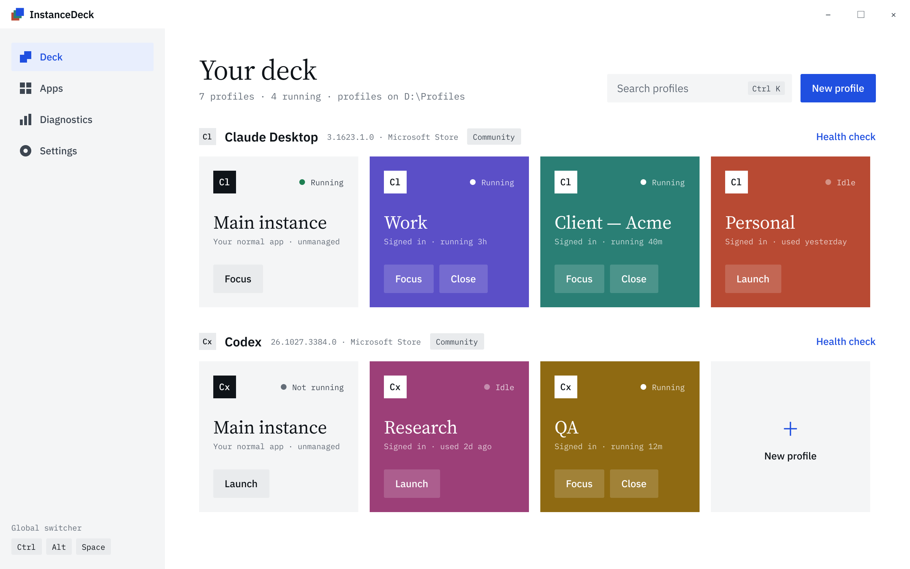
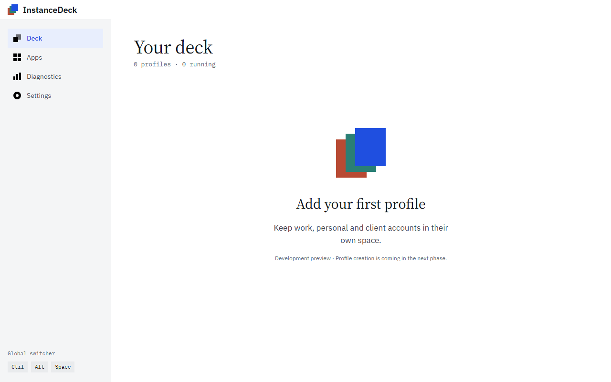
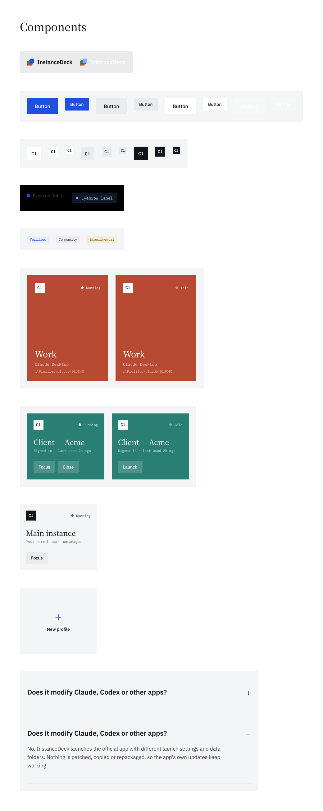
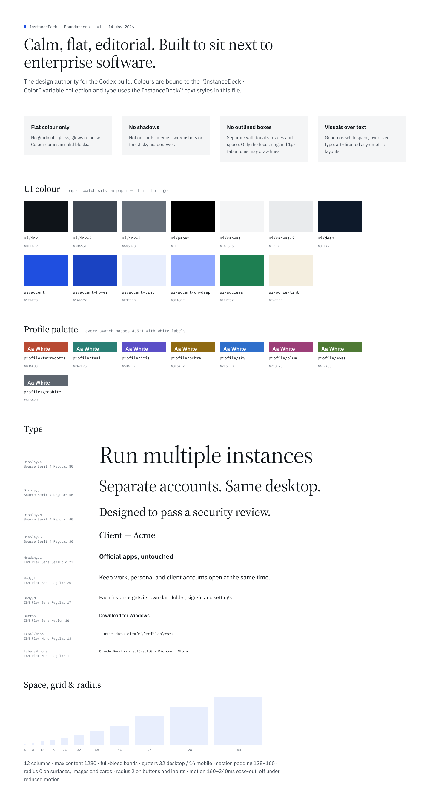
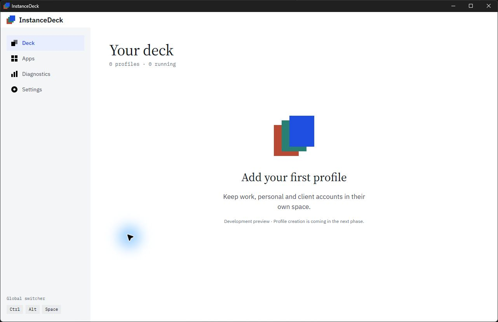
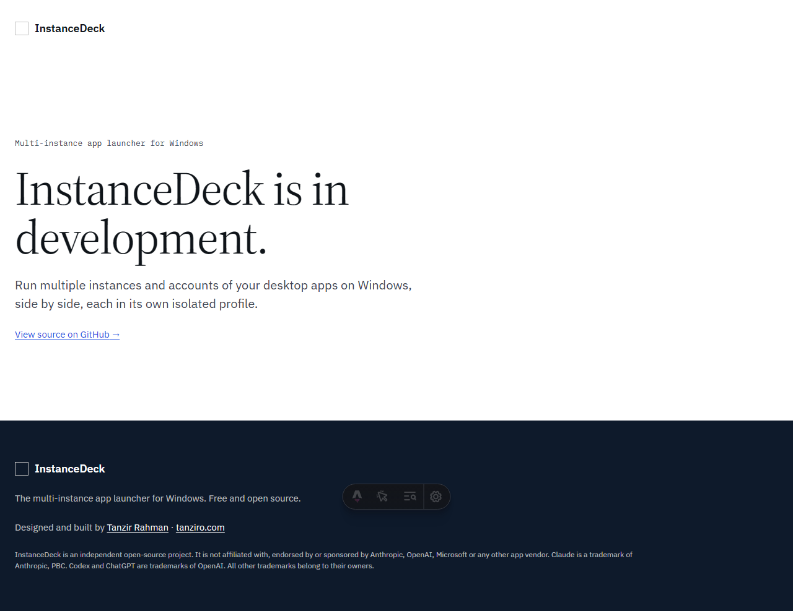

# Phase 0 evidence

Screenshots are produced by `pnpm test:smoke` and saved here. `native-empty.jpg`
records the real Windows WebView2 app (not the Vite browser preview).

P0 compares foundations, the Button and the empty Deck shell. The supplied Figma
Deck includes populated profiles; matching that screen belongs to P2. The site
is a scaffold, not the P6 landing-page implementation.

| Reference | Built |
| --- | --- |
|  |  |
|  | [Button stories](http://127.0.0.1:6006/?path=/story/components-button--primary) |
|  | [Generated tokens story](http://127.0.0.1:6006/?path=/story/foundations-tokens--foundations) |

Native verification: 

Site scaffold: 
